# Laporan Resmi Praktikum Komdat-Jarkom Modul 1

> **Kelompok K-59**
> * Salsabila Rafa Syafira (5027251059)
> * Fiorellin Ilona (5027251082)

---

## Daftar Isi
* [Soal 1](#soal-1)
* [Soal 2](#soal-2)
* [Soal 3](#soal-3)
* [Soal 4](#soal-4)
* [Soal 5](#soal-5)
* [Soal 6](#soal-6)
* [Soal 7](#soal-7)
* [Soal 8](#soal-8)
* [Soal 9](#soal-9)
* [Soal 10](#soal-10)
* [Soal 11](#soal-11)
* [Soal 12](#soal-12)
* [Soal 13](#soal-13)
* [Soal 14](#soal-14)
* [Soal 15](#soal-15)
* [Soal 16](#soal-16)
* [Soal 17](#soal-17)
* [Soal 18](#soal-18)
* [Soal 19](#soal-19)
* [Soal 20](#soal-20)

---

### Informasi Jaringan

- IP Address Host: `10.4.89.250`
- Prefix IP: `10.93.x.x`
- Platform: GNS3 Web

### Pembagian Peran Node GNS3

| Node | Peran | OS |
|---|---|---|
| `jichi` | Router utama, DHCP relay | Debian |
| `tengen` | DHCP server | Debian |
| `utahime` | DNS master | Debian |
| `shoko` | DNS slave | Debian |
| `gojo` | Public reverse proxy Nginx | Debian |
| `itadori` | Klien DHCP Pool 1 | Alpine |
| `fushiguro` | Klien DHCP Pool 1 | Alpine |
| `zenin` | Klien DHCP Pool 2 | Alpine |
| `okkotsu` | Klien DHCP Pool 2 | Alpine |
| `ino` | Klien dengan short lease | Alpine |
| `kusakabe` | Klien dengan short lease | Alpine |
| `miwa` | Klien dengan long lease | Alpine |
| `kugisaki` | Klien dengan fixed address | Alpine |
| `geto` | Internal load balancer Nginx | Debian |
| `maki` | Worker frontend | Debian |
| `panda` | Worker frontend | Debian |
| `nanami` | Worker API utama | Debian |
| `todo` | Worker API utama | Debian |
| `kirara` | Worker API cadangan | Debian |
| `yaga` | Database master MariaDB | Debian |
| `inumaki` | Database slave MariaDB | Debian |

### Pemetaan Node dan Koneksi

| No. | Node Asal | Interface Asal | Node Tujuan | Interface Tujuan |
|---:|---|---|---|---|
| 1 | NAT1 (nat0) | - | jichi | eth0 |
| 2 | jichi | eth1 | Switch1 | e0 |
| 3 | jichi | eth2 | Switch2 | e0 |
| 4 | jichi | eth3 | Switch4 | e0 |
| 5 | jichi | eth4 | Switch6 | e0 |
| 6 | Switch1 | e1 | utahime | eth0 |
| 7 | Switch1 | e2 | shoko | eth0 |
| 8 | Switch1 | e3 | gojo | eth0 |
| 9 | Switch2 | e1 | Switch3 | e0 |
| 10 | Switch2 | e2 | Switch9 | e0 |
| 11 | Switch3 | e1 | itadori | eth0 |
| 12 | Switch3 | e2 | fushiguro | eth0 |
| 13 | Switch9 | e1 | zenin | eth0 |
| 14 | Switch9 | e2 | okkotsu | eth0 |
| 15 | Switch6 | e1 | Switch7 | e0 |
| 16 | Switch6 | e2 | Switch10 | e0 |
| 17 | Switch7 | e1 | geto | e0 |
| 18 | Switch7 | e2 | maki | e0 |
| 19 | Switch7 | e3 | panda | e0 |
| 20 | Switch7 | e4 | nanami | e0 |
| 21 | Switch7 | e5 | todo | e0 |
| 22 | Switch7 | e6 | kirara | e0 |
| 23 | Switch10 | e1 | tengen | e0 |
| 24 | Switch10 | e2 | yoga | e0 |
| 25 | Switch10 | e3 | inumaki | e0 |
| 26 | Switch4 | e1 | Switch5 | e0 |
| 27 | Switch4 | e2 | Switch8 | e0 |
| 28 | Switch5 | e1 | ino | eth0 |
| 29 | Switch5 | e2 | kusakabe | eth0 |
| 30 | Switch8 | e1 | kugisaki | eth0 |
| 31 | Switch8 | e2 | miwa | eth0 |

# Pembahasan

## Soal 1
### Perintah soal
Konfigurasi jichi: eth0 WAN dari NAT, eth1-eth4 gateway Network 1-4  
Aktifkan IPv4 forwarding dan source NAT (MASQUERADE)  
Tetapkan IP statis host infrastruktur dan nameserver 192.168.122.1   
Uji konektivitas setiap host ke gateway dan akses eksternal   

### Langkah pengerjaan
1. Config di root jichi
   
   ```bash
   cat << 'EOF' > /root/soal1.sh
   #!/bin/bash

   # Atur nameserver awal
   echo "nameserver 192.168.122.1" > /etc/resolv.conf

   # Aktifkan IPv4 Forwarding
   echo 1 > /proc/sys/net/ipv4/ip_forward
   grep -q "net.ipv4.ip_forward=1" /etc/sysctl.conf || echo "net.ipv4.ip_forward=1" >> /etc/sysctl.conf
   sysctl -p /etc/sysctl.conf 2>/dev/null

   # Konfigurasi IPTables NAT & Forwarding
   iptables -P FORWARD ACCEPT
   iptables -F FORWARD
   iptables -t nat -F
   iptables -t nat -A POSTROUTING -o eth0 -j MASQUERADE

   echo "Konfigurasi jichi (Soal 1) selesai dan aktif."
   EOF
   ```
   Jalankan script
   ```
   chmod +x /root/soal1.sh  
   /root/soal1.sh  
   ```
   Untuk semua node yang lain, jalankan ini
   ```
   echo "nameserver 192.168.122.1" > /etc/resolv.conf
   ```

2. Pengujian  
   Dari jichi
   ```
   ping -c 3 8.8.8.8
   ```
   Dari tengen  
   ```
   ping -c 3 10.93.4.1
   ping -c 3 192.168.122.1
   ping -c 3 8.8.8.8
   ```
   Dari utahime / gojo
   ```
   ping -c 3 10.93.1.1
   ```
<br><br>
---

## Soal 2
### Perintah soal
Tengen, penjaga pusat distribusi di Data Center, harus mengambil alih pengalokasian alamat bagi wilayah yang membutuhkan konfigurasi dinamis:
1. **Konfigurasi `isc-dhcp-server` pada `tengen` (`10.93.4.10`)**: Menginstal dan mengonfigurasi DHCP server pada node `tengen`.
2. **Deklarasikan Network 4 (`10.93.4.0/24`) sebagai subnet lokal tanpa pool dinamis**:
   - ISC DHCP Server mewajibkan deklarasi subnet tempat interface fisik yang mendengarkan berada (`eth0` dengan IP `10.93.4.10`).
   - Jika subnet `10.93.4.0/24` tidak dideklarasikan di `dhcpd.conf`, service akan gagal start / crash dengan pesan error: `"No subnet declaration for eth0 (10.93.4.10)"`.
   - Karena Network 4 adalah Data Center dengan IP statis, deklarasi dibuat kosong `{}` tanpa parameter `range`.
3. **Siapkan scope DHCP untuk Network 2 (`10.93.2.0/24`) dan Network 3 (`10.93.3.0/24`)**:
   - Scope untuk Divisi A (Network 2) dan Divisi B (Network 3) didefinisikan agar saat request DHCP diteruskan oleh DHCP Relay (`jichi`), `tengen` dapat mengenali subnet asal request dan mendistribusikan parameter jaringan (seperti gateway router, broadcast, dan DNS server).
4. **Validasi konfigurasi dan pastikan service aktif tanpa error**:
   - Mengecek sintaks konfigurasi menggunakan perintah `dhcpd -t -cf /etc/dhcp/dhcpd.conf`.
   - Memastikan service berjalan (`active (running)`) dan listening pada UDP port 67.

---

### Penempatan Script pada Node

Seluruh script instalasi, konfigurasi, dan pengujian disimpan di direktori `/root` masing-masing node agar tidak hilang.

| Node | File Script | Fungsi |
|---|---|---|
| **`tengen`** | `/root/soal2.sh` | Instalasi `isc-dhcp-server`, konfigurasi interface `eth0`, deklarasi subnet Network 4, 2, 3 di `dhcpd.conf`, validasi, dan restart service |
| **`tengen`** | `/root/soal2_testing.sh` | Validasi sintaks `dhcpd -t`, cek status layanan, verifikasi port UDP 67, dan cek syslog |
| **`jichi`** | `/root/soal2_testing.sh` | Pengujian konektivitas router jichi ke DHCP Server `tengen` (Network 4) |

---

### Langkah Pengerjaan

#### 1. Pada Node `tengen` (DHCP Server)

Buka terminal node **`tengen`**, buat file `/root/soal2.sh`:

```bash
nano /root/soal2.sh
```

Isikan script berikut:

```bash
#!/bin/bash

# 1. Atur DNS awal dan pastikan IP statis tengen 10.93.4.10
echo "nameserver 192.168.122.1" > /etc/resolv.conf

ip addr flush dev eth0 2>/dev/null || true
ip addr add 10.93.4.10/24 dev eth0
ip link set eth0 up
ip route replace default via 10.93.4.1 dev eth0 2>/dev/null || true

# 2. Instalasi paket isc-dhcp-server
echo "=== Menginstal isc-dhcp-server ==="
apt-get update -y
apt-get install -y isc-dhcp-server

# 3. Konfigurasi interface pendengar pada /etc/default/isc-dhcp-server
echo "=== Mengonfigurasi Interface DHCP ==="
sed -i 's/^INTERFACESv4=.*/INTERFACESv4="eth0"/' /etc/default/isc-dhcp-server
sed -i 's/^INTERFACES=.*/INTERFACES="eth0"/' /etc/default/isc-dhcp-server

# 4. Konfigurasi /etc/dhcp/dhcpd.conf
echo "=== Menulis /etc/dhcp/dhcpd.conf ==="
cat << 'EOCONF' > /etc/dhcp/dhcpd.conf
default-lease-time 600;
max-lease-time 7200;
ddns-update-style none;
authoritative;

# Subnet lokal Network 4 (Data Center) - Dideklarasikan TANPA pool dinamis
# Wajib dideklarasikan agar daemon tidak exit dengan error: "No subnet declaration for eth0"
subnet 10.93.4.0 netmask 255.255.255.0 {
}

# Scope DHCP untuk Network 2 (Divisi A - Klien via DHCP Relay)
subnet 10.93.2.0 netmask 255.255.255.0 {
    option routers 10.93.2.1;
    option broadcast-address 10.93.2.255;
    option domain-name-servers 10.93.1.2, 10.93.1.3;
}

# Scope DHCP untuk Network 3 (Divisi B - Klien via DHCP Relay)
subnet 10.93.3.0 netmask 255.255.255.0 {
    option routers 10.93.3.1;
    option broadcast-address 10.93.3.255;
    option domain-name-servers 10.93.1.2, 10.93.1.3;
}
EOCONF

# 5. Validasi konfigurasi dhcpd
echo "=== Validasi Konfigurasi dhcpd.conf ==="
dhcpd -t -cf /etc/dhcp/dhcpd.conf

# 6. Restart dan jalankan service isc-dhcp-server
service isc-dhcp-server restart

# 7. Cek status service
echo "=== Status Service isc-dhcp-server ==="
service isc-dhcp-server status
```

Beri izin eksekusi dan jalankan script:

```bash
chmod +x /root/soal2.sh
/root/soal2.sh
```

---

### Script Testing

#### 1. Pada Node `tengen`

Buka terminal node **`tengen`**, buat file `/root/soal2_testing.sh`:

```bash
nano /root/soal2_testing.sh
```

Isikan script pengujian berikut:

```bash
#!/bin/bash

echo "TESTING SOAL 2: NODE tengen (DHCP Server)"

# 1. Validasi sintaks dhcpd.conf
echo -e "\n[1] Validasi Sintaks dhcpd.conf (dhcpd -t):"
if dhcpd -t -cf /etc/dhcp/dhcpd.conf; then
    echo ">>> [OK] Sintaks dhcpd.conf valid."
else
    echo ">>> [ERROR] Terdapat kesalahan sintaks pada dhcpd.conf."
fi

# 2. Cek status service isc-dhcp-server
echo -e "\n[2] Status Service isc-dhcp-server:"
service isc-dhcp-server status

# 3. Verifikasi Port DHCP (UDP Port 67)
echo -e "\n[3] Pengecekan Port UDP 67 (Listening):"
if netstat -ulnp 2>/dev/null | grep -E ':67\b'; then
    echo ">>> [OK] isc-dhcp-server aktif mendengarkan di UDP port 67."
elif ss -ulpn 2>/dev/null | grep -E ':67\b'; then
    echo ">>> [OK] isc-dhcp-server aktif mendengarkan di UDP port 67."
else
    echo ">>> [PERINGATAN] Port 67 belum terdeteksi aktif."
fi

# 4. Pengecekan log apakah ada error 'No subnet declaration'
echo -e "\n[4] Pengecekan Error 'No subnet declaration' di Syslog:"
if grep -i "No subnet declaration" /var/log/syslog 2>/dev/null; then
    echo ">>> [PERINGATAN] Ditemukan pesan 'No subnet declaration' di syslog."
else
    echo ">>> [OK] Bersih. Tidak ada error 'No subnet declaration'."
fi

# 5. Uji konektivitas gateway jichi
echo -e "\n[5] Tes Ping ke Gateway jichi (10.93.4.1):"
ping -c 3 10.93.4.1
```

Beri izin eksekusi dan jalankan:

```bash
chmod +x /root/soal2_testing.sh
/root/soal2_testing.sh
```

---

#### 2. Pada Node `jichi`

Buka terminal node **`jichi`**, buat file `/root/soal2_testing.sh`:

```bash
nano /root/soal2_testing.sh
```

Isikan script pengujian berikut:

```bash
#!/bin/bash

echo "TESTING SOAL 2: NODE jichi (Koneksi ke DHCP Server)"

echo -e "\n[1] Uji Ping ke DHCP Server tengen (10.93.4.10):"
ping -c 3 10.93.4.10

echo -e "\n[2] Status Interface eth4 (Gateway Network 4):"
ip -br a show eth4
```

Beri izin eksekusi dan jalankan:

```bash
chmod +x /root/soal2_testing.sh
/root/soal2_testing.sh
```
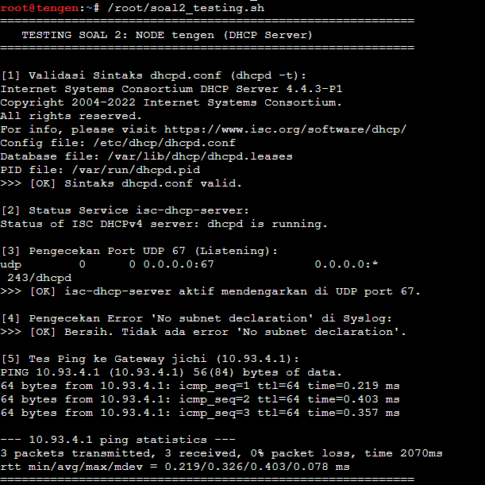  

<br>Tampilan di node jichi<br>  

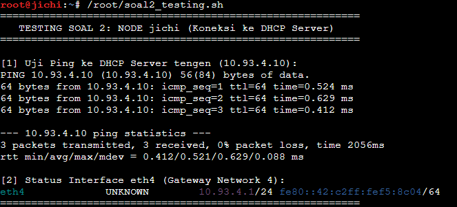
---

## Soal 3
### Perintah soal
Permintaan alamat dari Divisi A dan Divisi B tidak dapat menyeberangi subnet secara langsung:
1. **Masalah Subnet & DHCP Broadcast:**
   - Klien Divisi A berada di **Network 2 (`10.93.2.0/24`)** dan Klien Divisi B berada di **Network 3 (`10.93.3.0/24`)**, sedangkan DHCP Server `tengen` berada di **Network 4 (`10.93.4.10`)**.
   - Paket `DHCPDISCOVER` dikirimkan secara broadcast (`255.255.255.255`) oleh klien. Secara default, router tidak akan meneruskan paket broadcast antar subnet.
2. **Konfigurasi DHCP Relay pada `jichi`:**
   - Router `jichi` dikonfigurasikan sebagai DHCP Relay menggunakan daemon `isc-dhcp-relay`.
   - Relay bertugas menangkap paket broadcast DHCP dari interface klien (**`eth2`** untuk Network 2 dan **`eth3`** untuk Network 3), menyematkan IP interface gateway router pada field `giaddr` (*Gateway IP Address*), lalu mem-forward paket tersebut secara unicast ke DHCP Server `tengen` (`10.93.4.10`) melalui **`eth4`**.
3. **Penyediaan Pool Range pada `tengen`:**
   - Agar `tengen` dapat memberikan lease saat request tiba melalui relay, scope Network 2 dan Network 3 harus memiliki rentang pool IP yang aktif.
4. **Pembuktian Lease pada Klien:**
   - Menguji permintaan IP pada klien Network 2 (`itadori`) dan Network 3 (`ino`) untuk membuktikan bahwa klien berhasil memperoleh konfigurasi IP, subnet mask, gateway, dan DNS melalui DHCP Relay.

---

### Penempatan Script pada Node

Seluruh script instalasi, konfigurasi, dan pengujian disimpan di direktori `/root` masing-masing node agar tidak hilang.

| Node | File Script | Fungsi |
|---|---|---|
| **`tengen`** | `/root/soal3.sh` | Menambahkan rentang IP dinamis (*pool*) untuk Network 2 & 3 pada `dhcpd.conf` dan restart service |
| **`jichi`** | `/root/soal3.sh` | Instalasi `isc-dhcp-relay`, pengaturan interface `eth2 eth3 eth4`, target server `10.93.4.10`, dan start service relay |
| **`jichi`** | `/root/soal3_testing.sh` | Memverifikasi status layanan `isc-dhcp-relay`, proses `dhcrelay`, dan forwarding |
| **`tengen`** | `/root/soal3_testing.sh` | Memeriksa riwayat lease di `/var/lib/dhcp/dhcpd.leases` dan log syslog |
| **`itadori` / `ino`** | `/root/soal3_testing.sh` | Meminta IP via DHCP (`udhcpc`), menampilkan alamat IP, route, dan uji konektivitas |

---

### Langkah Pengerjaan

#### 1. Pada Node `tengen` (DHCP Server)

Buka terminal node **`tengen`**, buat file `/root/soal3.sh`:

```bash
nano /root/soal3.sh
```

Isikan script berikut:

```bash
#!/bin/bash
# Script config tengen (Penyediaan Pool untuk Relay)

cat << 'EOCONF' > /etc/dhcp/dhcpd.conf
default-lease-time 600;
max-lease-time 7200;
ddns-update-style none;
authoritative;

# Subnet lokal Network 4 (Data Center) - Tanpa pool dinamis
subnet 10.93.4.0 netmask 255.255.255.0 {
}

# Scope DHCP Network 2 (Divisi A) - Dengan range dinamis untuk relay
subnet 10.93.2.0 netmask 255.255.255.0 {
    range 10.93.2.10 10.93.2.50;
    option routers 10.93.2.1;
    option broadcast-address 10.93.2.255;
    option domain-name-servers 10.93.1.2, 10.93.1.3;
}

# Scope DHCP Network 3 (Divisi B) - Dengan range dinamis untuk relay
subnet 10.93.3.0 netmask 255.255.255.0 {
    range 10.93.3.10 10.93.3.50;
    option routers 10.93.3.1;
    option broadcast-address 10.93.3.255;
    option domain-name-servers 10.93.1.2, 10.93.1.3;
}
EOCONF

# Validasi dan restart service
echo "=== Validasi Konfigurasi dhcpd.conf ==="
dhcpd -t -cf /etc/dhcp/dhcpd.conf

service isc-dhcp-server restart
echo "=== Status Layanan isc-dhcp-server ==="
service isc-dhcp-server status
```

Beri izin eksekusi dan jalankan script di `tengen`:

```bash
chmod +x /root/soal3.sh
/root/soal3.sh
```

---

#### 2. Pada Node `jichi` (DHCP Relay)

Buka terminal node **`jichi`**, buat file `/root/soal3.sh`:

```bash
nano /root/soal3.sh
```

Isikan script berikut:

```bash
#!/bin/bash
# config jichi (DHCP Relay)

# 1. Atur DNS awal untuk unduh paket jika diperlukan
echo "nameserver 192.168.122.1" > /etc/resolv.conf

# 2. Pastikan IP forwarding aktif
echo 1 > /proc/sys/net/ipv4/ip_forward
sed -i 's/#net.ipv4.ip_forward=1/net.ipv4.ip_forward=1/g' /etc/sysctl.conf 2>/dev/null
grep -q "net.ipv4.ip_forward=1" /etc/sysctl.conf || echo "net.ipv4.ip_forward=1" >> /etc/sysctl.conf
sysctl -p /etc/sysctl.conf 2>/dev/null

# 3. Instal paket isc-dhcp-relay secara non-interaktif
echo "=== Menginstal isc-dhcp-relay ==="
export DEBIAN_FRONTEND=noninteractive
apt-get update -y
apt-get install -y isc-dhcp-relay

# 4. Konfigurasi /etc/default/isc-dhcp-relay
# eth2: Network 2 (Divisi A)
# eth3: Network 3 (Divisi B)
# eth4: Network 4 (menghubungkan jichi ke DHCP Server tengen 10.93.4.10)
echo "=== Menulis /etc/default/isc-dhcp-relay ==="
cat << 'EOF' > /etc/default/isc-dhcp-relay
SERVERS="10.93.4.10"
INTERFACES="eth2 eth3 eth4"
OPTIONS=""
EOF

# 5. Restart dan jalankan service isc-dhcp-relay
echo "=== Menjalankan service isc-dhcp-relay ==="
service isc-dhcp-relay restart || /etc/init.d/isc-dhcp-relay restart

# 6. Tampilkan status service
echo "=== Status Layanan isc-dhcp-relay ==="
ps aux | grep dhcrelay | grep -v grep
```

Beri izin eksekusi dan jalankan script di `jichi`:

```bash
chmod +x /root/soal3.sh
/root/soal3.sh
```

---

### Script Testing

#### 1. Pada Node `jichi` (Pengujian Status Relay)

Buka terminal node **`jichi`**, buat file `/root/soal3_testing.sh`:

```bash
nano /root/soal3_testing.sh
```

Isikan script berikut:

```bash
#!/bin/bash
echo "   TESTING SOAL 3: NODE jichi (DHCP Relay)"

echo -e "\n[1] Status Layanan isc-dhcp-relay:"
service isc-dhcp-relay status || /etc/init.d/isc-dhcp-relay status

echo -e "\n[2] Memeriksa Proses dhcrelay:"
if ps aux | grep -v grep | grep dhcrelay >/dev/null; then
    echo ">>> [OK] Daemon dhcrelay aktif berjalan:"
    ps aux | grep -v grep | grep dhcrelay
else
    echo ">>> [ERROR] Daemon dhcrelay tidak ditemukan berjalan!"
fi

echo -e "\n[3] Konfigurasi /etc/default/isc-dhcp-relay:"
cat /etc/default/isc-dhcp-relay

echo -e "\n[4] Status IPv4 Forwarding:"
cat /proc/sys/net/ipv4/ip_forward

echo -e "\n[5] Tes Konektivitas ke DHCP Server tengen (10.93.4.10):"
ping -c 3 10.93.4.10
```

Beri izin eksekusi dan jalankan:

```bash
chmod +x /root/soal3_testing.sh
/root/soal3_testing.sh
```

---

#### 2. Pada Node `tengen` (Pengujian Leases di Server)

Buka terminal node **`tengen`**, buat file `/root/soal3_testing.sh`:

```bash
nano /root/soal3_testing.sh
```

Isikan script berikut:

```bash
#!/bin/bash
echo "   TESTING NODE tengen (DHCP Server Leases)"

echo -e "\n[1] Status Layanan isc-dhcp-server:"
service isc-dhcp-server status

echo -e "\n[2] Daftar IP Lease Aktif (/var/lib/dhcp/dhcpd.leases):"
if [ -f /var/lib/dhcp/dhcpd.leases ]; then
    grep -E "^lease" /var/lib/dhcp/dhcpd.leases || echo "Belum ada lease yang tercatat."
fi

echo -e "\n[3] Log Aktivitas Relay DHCP di Syslog:"
grep -E "DHCP(DISCOVER|OFFER|REQUEST|ACK)" /var/log/syslog 2>/dev/null | tail -n 15 || echo "Log syslog kosong atau belum ada request."
echo "=========================================================="
```

Beri izin eksekusi dan jalankan:

```bash
chmod +x /root/soal3_testing.sh
/root/soal3_testing.sh
```

---

#### 3. Pada Klien Network 2 (`itadori`) dan Network 3 (`ino`)

Jalankan pengujian ini pada terminal klien **`itadori`** (Divisi A) dan **`ino`** (Divisi B) untuk meminta alamat melalui relay:

Buat file `/root/soal3_testing.sh` pada klien:

```bash
nano /root/soal3_testing.sh
```

Isikan script berikut:

```bash
#!/bin/bash
echo "   TESTING KLIEN DHCP (Alpine Linux)"

echo -e "\n[1] Meminta / Memperbarui IP Lease melalui DHCP (udhcpc):"
udhcpc -i eth0 -n -q

echo -e "\n[2] Status IP Address eth0:"
ip -br a show eth0

echo -e "\n[3] Routing Table:"
ip route

echo -e "\n[4] Pengujian Koneksi ke DHCP Server (10.93.4.10):"
ping -c 3 10.93.4.10
```

Beri izin eksekusi dan jalankan pada masing-masing klien:

```bash
chmod +x /root/soal3_testing.sh
/root/soal3_testing.sh
```

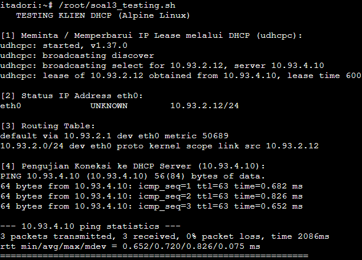
---

## Soal 4
### Perintah soal
Permintaan pembagian dua pool DHCP pada Network 2 untuk tim Dev dan Support di Divisi A:
1. **Pembagian Kelompok & Alokasi Pool:**
   - **Tim Dev:** Personal `itadori` dan `fushiguro` harus memperoleh alamat dari **Pool 1 (`10.93.2.10 - 10.93.2.35`)**.
   - **Tim Support:** Personal `zenin` dan `okkotsu` harus memperoleh alamat dari **Pool 2 (`10.93.2.70 - 10.93.2.95`)**.
   - **Rentang Terlarang:** Alamat `10.93.2.36 - 10.93.2.69` tidak boleh dialokasikan ke siapapun.
2. **Penerapan DHCP Class & Subclass (Berdasarkan MAC Address):**
   - Karena keempat klien berada di subnet yang sama (`10.93.2.0/24`), ISC DHCP Server menggunakan fitur **`class`** dan **`subclass`** untuk memetakan MAC Address masing-masing klien:
     - `itadori`: `02:42:04:d1:3c:00` (Tim Dev -> Pool 1)
     - `fushiguro`: `02:42:8a:fc:d0:00` (Tim Dev -> Pool 1)
     - `zenin`: `02:42:42:2e:33:00` (Tim Support -> Pool 2)
     - `okkotsu`: `02:42:86:56:6e:00` (Tim Support -> Pool 2)
   - Di dalam blok `subnet 10.93.2.0`, didefinisikan dua blok `pool` terpisah:
     - `pool { allow members of "pool1-dev"; range 10.93.2.10 10.93.2.35; }`
     - `pool { allow members of "pool2-support"; range 10.93.2.70 10.93.2.95; }`
   - Rentang `10.93.2.36 - 10.93.2.69` otomatis terlindungi dan tidak akan pernah diberikan ke klien karena tidak dicantumkan pada blok pool manapun.

---

### Penempatan Script pada Node

| Node | File Script | Fungsi |
|---|---|---|
| **`tengen`** | `/root/soal4.sh` | Mengonfigurasi DHCP class, pemetaan subclass MAC Address, dan 2 pool terpisah di `dhcpd.conf` |
| **`jichi`** | `/root/soal4.sh` | Memastikan DHCP Relay tetap aktif dan meneruskan paket Network 2 ke `tengen` |
| **`tengen`** | `/root/soal4_testing.sh` | Memeriksa log alokasi lease di `/var/lib/dhcp/dhcpd.leases` |
| **`jichi`** | `/root/soal4_testing.sh` | Memeriksa proses relay dan konektivitas |
| **`itadori` / `fushiguro`** | `/root/soal4_testing.sh` | Meminta IP DHCP dan memverifikasi alokasi Pool 1 (`10.93.2.10 - 10.93.2.35`) |
| **`zenin` / `okkotsu`** | `/root/soal4_testing.sh` | Meminta IP DHCP dan memverifikasi alokasi Pool 2 (`10.93.2.70 - 10.93.2.95`) |

---

### Langkah Pengerjaan

#### 1. Pada Node `tengen` (DHCP Server)

Buka terminal node **`tengen`**, buat file `/root/soal4.sh`:

```bash
nano /root/soal4.sh
```

Isikan script berikut:

```bash
#!/bin/bash
# Script config tengen (DHCP Class & Pool Network 2)

cat << 'EOCONF' > /etc/dhcp/dhcpd.conf
default-lease-time 600;
max-lease-time 7200;
ddns-update-style none;
authoritative;

# 1. Definisi Class untuk Klien Network 2 (Divisi A)
class "pool1-dev" {
    match pick-first-value (option dhcp-client-identifier, hardware);
}

class "pool2-support" {
    match pick-first-value (option dhcp-client-identifier, hardware);
}

# 2. Pemetaan Member berdasarkan MAC Address
# Tim Dev (itadori & fushiguro)
subclass "pool1-dev" 1:02:42:04:d1:3c:00;
subclass "pool1-dev" 1:02:42:8a:fc:d0:00;

# Tim Support (zenin & okkotsu)
subclass "pool2-support" 1:02:42:42:2e:33:00;
subclass "pool2-support" 1:02:42:86:56:6e:00;

# Subnet lokal Network 4 (Data Center) - Tanpa pool dinamis
subnet 10.93.4.0 netmask 255.255.255.0 {
}

# Scope DHCP Network 2 (Divisi A)
subnet 10.93.2.0 netmask 255.255.255.0 {
    option routers 10.93.2.1;
    option broadcast-address 10.93.2.255;
    option domain-name-servers 10.93.1.2, 10.93.1.3;

    # Pool 1: Khusus Tim Dev (10.93.2.10 - 10.93.2.35)
    pool {
        allow members of "pool1-dev";
        range 10.93.2.10 10.93.2.35;
    }

    # Pool 2: Khusus Tim Support (10.93.2.70 - 10.93.2.95)
    # Rentang 10.93.2.36 - 10.93.2.69 sengaja dikosongkan dan tidak dialokasikan
    pool {
        allow members of "pool2-support";
        range 10.93.2.70 10.93.2.95;
    }
}

# Scope DHCP Network 3 (Divisi B) - Tetap aktif dari soal sebelumnya
subnet 10.93.3.0 netmask 255.255.255.0 {
    range 10.93.3.10 10.93.3.50;
    option routers 10.93.3.1;
    option broadcast-address 10.93.3.255;
    option domain-name-servers 10.93.1.2, 10.93.1.3;
}
EOCONF

# Validasi dan restart service
dhcpd -t -cf /etc/dhcp/dhcpd.conf
service isc-dhcp-server restart
service isc-dhcp-server status
```

Beri izin eksekusi dan jalankan di `tengen`:

```bash
chmod +x /root/soal4.sh
/root/soal4.sh
```

---

#### 2. Pada Node `jichi` (DHCP Relay)

Buka terminal node **`jichi`**, buat file `/root/soal4.sh`:

```bash
nano /root/soal4.sh
```

Isikan script berikut:

```bash
#!/bin/bash
# Script config jichi (Memastikan Relay Aktif)

echo 1 > /proc/sys/net/ipv4/ip_forward

cat << 'EOF' > /etc/default/isc-dhcp-relay
SERVERS="10.93.4.10"
INTERFACES="eth2 eth3 eth4"
OPTIONS=""
EOF

service isc-dhcp-relay restart || /etc/init.d/isc-dhcp-relay restart
ps aux | grep dhcrelay | grep -v grep
```

Beri izin eksekusi dan jalankan di `jichi`:

```bash
chmod +x /root/soal4.sh
/root/soal4.sh
```

---

### Script Testing

#### 1. Pada Node `tengen` (Pengujian Lease Server)

Buka terminal node **`tengen`**, buat file `/root/soal4_testing.sh`:

```bash
nano /root/soal4_testing.sh
```

Isikan script berikut:

```bash
#!/bin/bash
echo "TESTING SOAL 4: NODE tengen (DHCP Server)"

echo -e "\n[1] Status Layanan isc-dhcp-server:"
service isc-dhcp-server status

echo -e "\n[2] Log Lease Network 2 (/var/lib/dhcp/dhcpd.leases):"
if [ -f /var/lib/dhcp/dhcpd.leases ]; then
    grep -E "(lease 10\.93\.2\.|client-hostname|uid)" /var/lib/dhcp/dhcpd.leases || echo "Belum ada lease tercatat untuk Network 2."
fi
```

Beri izin eksekusi dan jalankan:

```bash
chmod +x /root/soal4_testing.sh
/root/soal4_testing.sh
```
<br>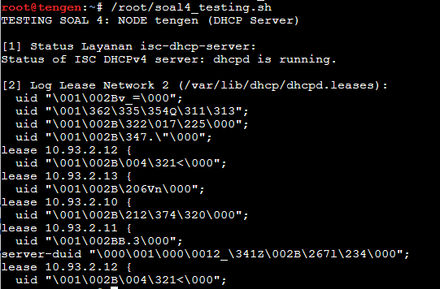<br>
---

#### 2. Pada Node `jichi` (Pengujian Status Relay)

Buka terminal node **`jichi`**, buat file `/root/soal4_testing.sh`:

```bash
nano /root/soal4_testing.sh
```

Isikan script berikut:

```bash
#!/bin/bash
echo "TESTING SOAL 4: NODE jichi (DHCP Relay)"

echo -e "\n[1] Status Layanan isc-dhcp-relay:"
if pidof dhcrelay >/dev/null; then
    echo ">>> [OK] Service isc-dhcp-relay is running (PID: $(pidof dhcrelay))."
else
    echo ">>> [ERROR] Service isc-dhcp-relay is not running."
fi

echo -e "\n[2] Memeriksa Proses dhcrelay:"
ps aux | grep -v grep | grep dhcrelay

echo -e "\n[3] Tes Konektivitas ke DHCP Server tengen (10.93.4.10):"
ping -c 3 10.93.4.10
```

Beri izin eksekusi dan jalankan:

```bash
chmod +x /root/soal4_testing.sh
/root/soal4_testing.sh
```
<br>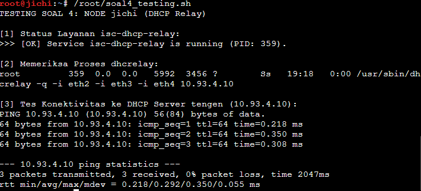<br>
---

#### 3. Pada Klien Divisi A (`itadori`, `fushiguro`, `zenin`, `okkotsu`)

Jalankan pengujian ini pada masing-masing terminal klien Divisi A:

Buat file `/root/soal4_testing.sh` pada klien:

```bash
nano /root/soal4_testing.sh
```

Isikan script berikut:

```bash
#!/bin/bash
CLIENT_NAME="$(hostname)"
echo "TESTING SOAL 4: KLIEN $CLIENT_NAME (Alpine Linux)"

echo -e "\n[1] Meminta Lease IP melalui DHCP (udhcpc):"
udhcpc -i eth0 -n -q

echo -e "\n[2] Status IP Address eth0:"
ip -br a show eth0

echo -e "\n[3] Routing Table:"
ip route

echo -e "\n[4] Pengujian Koneksi ke Gateway (10.93.2.1):"
ping -c 3 10.93.2.1
```

Beri izin eksekusi dan jalankan pada masing-masing klien:

```bash
chmod +x /root/soal4_testing.sh
/root/soal4_testing.sh
```

> **Target Alokasi IP yang Diharapkan:**
> - `itadori`: Mendapat IP antara `10.93.2.10` s.d. `10.93.2.35` (Pool 1 Dev)
> - `fushiguro`: Mendapat IP antara `10.93.2.10` s.d. `10.93.2.35` (Pool 1 Dev)
> - `zenin`: Mendapat IP antara `10.93.2.70` s.d. `10.93.2.95` (Pool 2 Support)
> - `okkotsu`: Mendapat IP antara `10.93.2.70` s.d. `10.93.2.95` (Pool 2 Support)  
<br>

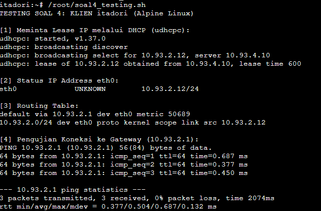<br>
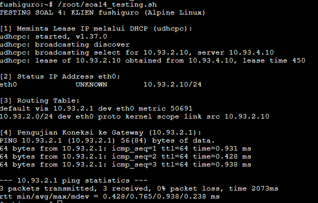<br>
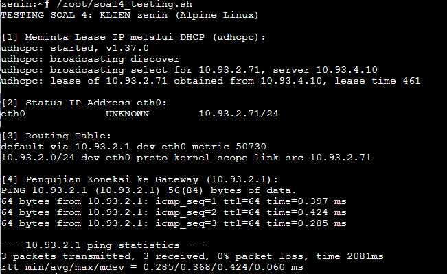<br>
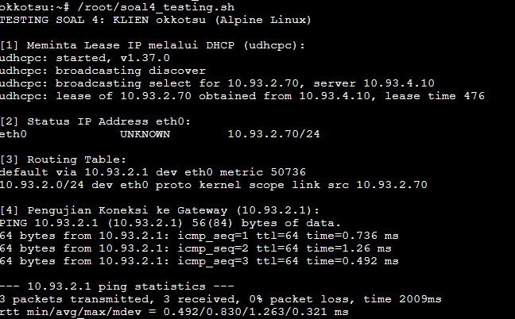
---

## Soal 5
### Perintah soal

Permintaan konfigurasi lease time berbeda dan opsi jaringan pada Network 3 (Divisi B):
1. **Klasifikasi Lease Time & Pool Alokasi:**
   - **Tim Short Lease (`ino` dan `kusakabe`):**
     - Durasi operasional: 30 menit (1800 detik).
     - Rentang Pool: **`10.93.3.10 - 10.93.3.89`**.
     - Nilai parameter: `default-lease-time 1800; max-lease-time 1800;`.
   - **Tim Long Lease (`miwa`):**
     - Durasi operasional: 12 jam (43200 detik).
     - Rentang Pool: **`10.93.3.100 - 10.93.3.199`**.
     - Nilai parameter: `default-lease-time 43200; max-lease-time 43200;`.
2. **Distribusi DHCP Options pada Network 3:**
   - Router Gateway: `10.93.3.1` (`option routers 10.93.3.1;`).
   - Broadcast Address: `10.93.3.255` (`option broadcast-address 10.93.3.255;`).
   - DNS Server: `10.93.1.2` dan `10.93.1.3` (`option domain-name-servers 10.93.1.2, 10.93.1.3;`).
   - Domain Search: `k59.com` (`option domain-name "k59.com"; option domain-search "k59.com";`).
3. **Penerapan DHCP Class & Subclass (Berdasarkan MAC Address):**
   - Dibuat dua class pada DHCP server: `"short-lease"` dan `"long-lease"` dengan pencocokan MAC Address:
     - `ino`: `02:42:d2:0f:95:00` (Short Lease 1800s / 30 menit)
     - `kusakabe`: `02:42:e7:2e:22:00` (Short Lease 1800s / 30 menit)
     - `miwa`: `f2:dd:ec:51:c9:cb` (Long Lease 43200s / 12 jam)
   - Parameter lease time dikonfigurasi spesifik per pool sehingga setiap kelas menerima masa sewa IP sesuai kebijakan.

---

### Penempatan Script pada Node

| Node | File Script | Fungsi |
|---|---|---|
| **`tengen`** | `/root/soal5.sh` | Konfigurasi class short lease & long lease, option DNS, search domain, serta pool Network 3 di `dhcpd.conf` |
| **`jichi`** | `/root/soal5.sh` | Memastikan DHCP Relay tetap aktif melayani Network 3 (`eth3`) ke `tengen` |
| **`tengen`** | `/root/soal5_testing.sh` | Memeriksa log durasi sewa lease pada `/var/lib/dhcp/dhcpd.leases` |
| **`jichi`** | `/root/soal5_testing.sh` | Memeriksa proses relay dan konektivitas |
| **`ino` / `kusakabe`** | `/root/soal5_testing.sh` | Meminta IP DHCP, verifikasi rentang pool short lease (`10.93.3.10 - 10.93.3.89`), dan cek `/etc/resolv.conf` |
| **`miwa`** | `/root/soal5_testing.sh` | Meminta IP DHCP, verifikasi rentang pool long lease (`10.93.3.100 - 10.93.3.199`), dan cek `/etc/resolv.conf` |

---

### Langkah Pengerjaan

#### 1. Pada Node `tengen` (DHCP Server)

Buka terminal node **`tengen`**, buat file `/root/soal5.sh`:

```bash
nano /root/soal5.sh
```

Isikan script berikut:

```bash
#!/bin/bash
# Script config tengen (Soal 5: Lease Time, DNS & Domain Search Network 3)

cat << 'EOCONF' > /etc/dhcp/dhcpd.conf
default-lease-time 600;
max-lease-time 7200;
ddns-update-style none;
authoritative;

# 1. Definisi Class Network 2 (Divisi A) - Soal 4
class "pool1-dev" {
    match pick-first-value (option dhcp-client-identifier, hardware);
}

class "pool2-support" {
    match pick-first-value (option dhcp-client-identifier, hardware);
}

subclass "pool1-dev" 1:02:42:04:d1:3c:00; # itadori
subclass "pool1-dev" 1:02:42:8a:fc:d0:00; # fushiguro
subclass "pool2-support" 1:02:42:42:2e:33:00; # zenin
subclass "pool2-support" 1:02:42:86:56:6e:00; # okkotsu

# 2. Definisi Class Network 3 (Divisi B) - Soal 5
class "short-lease" {
    match pick-first-value (option dhcp-client-identifier, hardware);
    default-lease-time 1800;
    max-lease-time 1800;
}

class "long-lease" {
    match pick-first-value (option dhcp-client-identifier, hardware);
    default-lease-time 43200;
    max-lease-time 43200;
}

# Subclass Klien Network 3 (Berdasarkan MAC Address)
# Tim Short Lease (ino & kusakabe)
subclass "short-lease" 1:02:42:d2:0f:95:00; # ino
subclass "short-lease" 1:02:42:e7:2e:22:00; # kusakabe

# Tim Long Lease (miwa)
subclass "long-lease" 1:f2:dd:ec:51:c9:cb;   # miwa

# Subnet lokal Network 4 (Data Center) - Tanpa pool dinamis
subnet 10.93.4.0 netmask 255.255.255.0 {
}

# Scope DHCP Network 2 (Divisi A)
subnet 10.93.2.0 netmask 255.255.255.0 {
    option routers 10.93.2.1;
    option broadcast-address 10.93.2.255;
    option domain-name-servers 10.93.1.2, 10.93.1.3;

    pool {
        allow members of "pool1-dev";
        range 10.93.2.10 10.93.2.35;
    }

    pool {
        allow members of "pool2-support";
        range 10.93.2.70 10.93.2.95;
    }
}

# Scope DHCP Network 3 (Divisi B) - Soal 5
subnet 10.93.3.0 netmask 255.255.255.0 {
    option routers 10.93.3.1;
    option broadcast-address 10.93.3.255;
    option domain-name-servers 10.93.1.2, 10.93.1.3;
    option domain-name "k59.com";
    option domain-search "k59.com";

    # Pool Short Lease: 1800 detik (30 menit) untuk ino dan kusakabe
    pool {
        allow members of "short-lease";
        range 10.93.3.10 10.93.3.89;
        default-lease-time 1800;
        max-lease-time 1800;
    }

    # Pool Long Lease: 43200 detik (12 jam) untuk miwa
    pool {
        allow members of "long-lease";
        range 10.93.3.100 10.93.3.199;
        default-lease-time 43200;
        max-lease-time 43200;
    }
}
EOCONF

# Validasi sintaks dan restart service
dhcpd -t -cf /etc/dhcp/dhcpd.conf
service isc-dhcp-server restart
service isc-dhcp-server status
```

Beri izin eksekusi dan jalankan di `tengen`:

```bash
chmod +x /root/soal5.sh
/root/soal5.sh
```

---

#### 2. Pada Node `jichi` (DHCP Relay)

Buka terminal node **`jichi`**, buat file `/root/soal5.sh`:

```bash
nano /root/soal5.sh
```

Isikan script berikut:

```bash
#!/bin/bash
# Script config jichi (Memastikan Relay Aktif untuk Network 3)

echo 1 > /proc/sys/net/ipv4/ip_forward

cat << 'EOF' > /etc/default/isc-dhcp-relay
SERVERS="10.93.4.10"
INTERFACES="eth2 eth3 eth4"
OPTIONS=""
EOF

service isc-dhcp-relay restart || /etc/init.d/isc-dhcp-relay restart
ps aux | grep dhcrelay | grep -v grep
```

Beri izin eksekusi dan jalankan di `jichi`:

```bash
chmod +x /root/soal5.sh
/root/soal5.sh
```

---

### Script Testing

#### 1. Pada Node `tengen` (Pengujian Lease Server)

Buka terminal node **`tengen`**, buat file `/root/soal5_testing.sh`:

```bash
nano /root/soal5_testing.sh
```

Isikan script berikut:

```bash
#!/bin/bash
echo "TESTING SOAL 5: NODE tengen (DHCP Server)"

echo -e "\n[1] Status Layanan isc-dhcp-server:"
service isc-dhcp-server status

echo -e "\n[2] Log Lease Network 3 (/var/lib/dhcp/dhcpd.leases):"
if [ -f /var/lib/dhcp/dhcpd.leases ]; then
    grep -E "(lease 10\.93\.3\.|starts|ends|hardware ethernet|client-hostname)" /var/lib/dhcp/dhcpd.leases || echo "Belum ada lease tercatat untuk Network 3."
fi
```

Beri izin eksekusi dan jalankan:

```bash
chmod +x /root/soal5_testing.sh
/root/soal5_testing.sh
```
---

#### 2. Pada Node `jichi` (Pengujian Status Relay)

Buka terminal node **`jichi`**, buat file `/root/soal5_testing.sh`:

```bash
nano /root/soal5_testing.sh
```

Isikan script berikut:

```bash
#!/bin/bash
echo "TESTING SOAL 5: NODE jichi (DHCP Relay)"

echo -e "\n[1] Status Layanan isc-dhcp-relay:"
if pidof dhcrelay >/dev/null; then
    echo ">>> [OK] Service isc-dhcp-relay is running (PID: $(pidof dhcrelay))."
else
    echo ">>> [ERROR] Service isc-dhcp-relay is not running."
fi

echo -e "\n[2] Memeriksa Proses dhcrelay:"
ps aux | grep -v grep | grep dhcrelay

echo -e "\n[3] Tes Konektivitas ke DHCP Server tengen (10.93.4.10):"
ping -c 3 10.93.4.10
```

Beri izin eksekusi dan jalankan:

```bash
chmod +x /root/soal5_testing.sh
/root/soal5_testing.sh
```

---

#### 3. Pada Klien Divisi B (`ino`, `kusakabe`, `miwa`)

Buka terminal klien **`ino`**, **`kusakabe`**, atau **`miwa`**:

Buat file `/root/soal5_testing.sh` pada klien:

```bash
nano /root/soal5_testing.sh
```

Isikan script berikut:

```bash
#!/bin/bash
CLIENT_NAME="$(hostname)"
echo "TESTING SOAL 5: KLIEN $CLIENT_NAME (Alpine Linux)"

echo -e "\n[1] Meminta Lease IP melalui DHCP (udhcpc):"
udhcpc -i eth0 -n -q

echo -e "\n[2] Status IP Address eth0:"
ip -br a show eth0

echo -e "\n[3] Routing Table:"
ip route

echo -e "\n[4] Konfigurasi DNS & Domain Search (/etc/resolv.conf):"
cat /etc/resolv.conf

echo -e "\n[5] Pengujian Koneksi ke Gateway (10.93.3.1):"
ping -c 3 10.93.3.1
```

Beri izin eksekusi dan jalankan pada masing-masing klien:

```bash
chmod +x /root/soal5_testing.sh
/root/soal5_testing.sh
```

> **Target Alokasi IP dan Lease yang Diharapkan:**
> - `ino`: Mendapat IP antara `10.93.3.10` s.d. `10.93.3.89` (Short Lease 1800 detik / 30 menit)
> - `kusakabe`: Mendapat IP antara `10.93.3.10` s.d. `10.93.3.89` (Short Lease 1800 detik / 30 menit)
> - `miwa`: Mendapat IP antara `10.93.3.100` s.d. `10.93.3.199` (Long Lease 43200 detik / 12 jam)
> - Seluruh klien menerima DNS `10.93.1.2`, `10.93.1.3` dan search domain `k59.com` di `/etc/resolv.conf`.

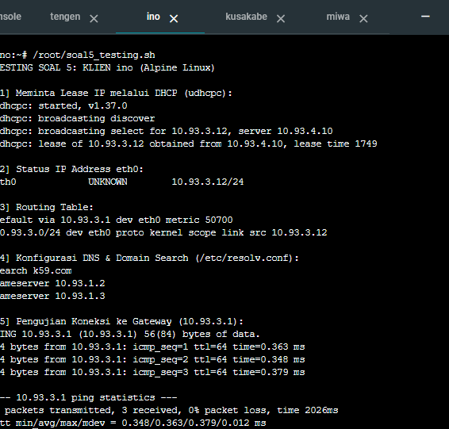<br>  
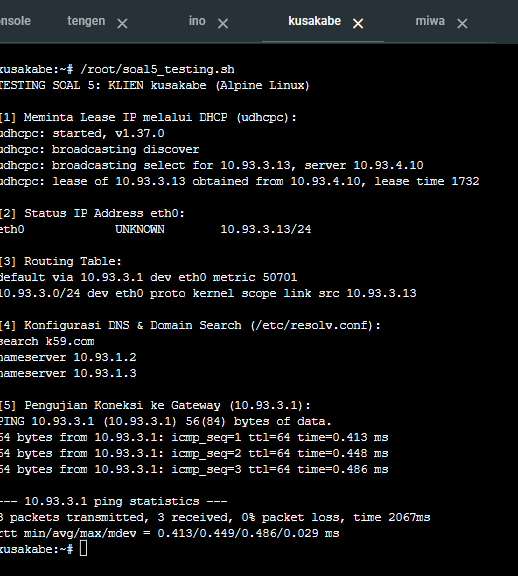<br>
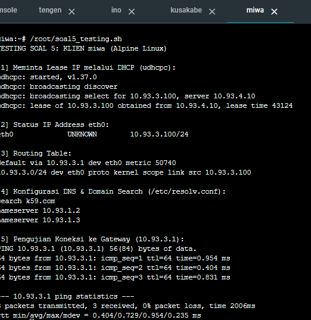
---

## Soal 6
### Perintah soal
Memberikan alamat IP tetap (Fixed Address) kepada klien kugisaki:
1. Identifikasi MAC Address: Mendapatkan MAC Address dari interface eth0 pada node kugisaki menggunakan perintah `ip link show eth0`.
2. Konfigurasi Fixed Address: Menambahkan blok `host kugisaki` pada file konfigurasi `/etc/dhcp/dhcpd.conf` di node `tengen` dengan mengikat MAC Address klien ke alamat statis `10.93.3.99` (berada di luar rentang pool short dan long lease).
3. Validasi & Pengujian: Melakukan validasi sintaks dhcpd, merestart layanan DHCP server, serta memperbarui sewa IP pada klien `kugisaki`.

Penempatan Script pada Node
| Node | File Script | Fungsi |
| --- | --- | --- |
| kugisaki | `/root/soal6_mac.sh` | Mengambil dan menampilkan MAC Address dari interface eth0 |
| tengen | `/root/soal6.sh` | Menambahkan blok konfigurasi fixed-address kugisaki dan merestart service |
| kugisaki | `/root/soal6_testing.sh` | Meminta ulang IP Lease via DHCP dan memverifikasi alamat IP |
   
### Langkah pengerjaan
1. Pada Node kugisaki (Mendapatkan MAC Address)
   Buka terminal node kugisaki, jalankan perintah untuk melihat MAC Address:
   
```bash
ip link show eth0 | grep ether
```
Catat MAC Address yang tampil

2. Pada Node tengen (DHCP Server)
   Buka terminal node tengen, buat file /root/soal6.sh:
   
   ```bash
   nano /root/soal6.sh
   #!/bin/bash
   cat << 'EOF' >> /etc/dhcp/dhcpd.conf

   host kugisaki {
    hardware ethernet 00:50:79:66:68:06;
    fixed-address 10.93.3.99;
   }
   EOF

   dhcpd -t -cf /etc/dhcp/dhcpd.conf
   service isc-dhcp-server restart
   service isc-dhcp-server status
   ```
   Beri izin eksekusi dan jalankan:

```Bash
   chmod +x /root/soal6.sh
   /root/soal6.sh
```

3. Script Testing
   Pada Node kugisaki: Buat file /root/soal6_testing.sh:

```Bash
nano /root/soal6_testing.sh
```
Isikan script pengujian berikut:

```Bash
#!/bin/bash
echo "TESTING SOAL 6: KLIEN kugisaki"
udhcpc -i eth0 -n -q
ip a show eth0
```
Beri izin eksekusi dan jalankan:

```Bash
chmod +x /root/soal6_testing.sh
/root/soal6_testing.sh
```


---

## Soal 7
### Perintah soal
Melakukan verifikasi menyeluruh terhadap konfigurasi jaringan pada seluruh klien (itadori, fushiguro, zenin, okkotsu, ino, kusakabe, miwa, kugisaki):

1. Verifikasi Network & Broadcast: Memastikan IP address yang diperoleh klien sesuai dengan alokasi subnet (/24) dan alamat broadcast yang benar (.2.255 atau .3.255).
2. Verifikasi Routing: Memastikan default gateway mengarah dengan tepat ke router lokal (.2.1 atau .3.1).
3. Verifikasi DNS Resolver: Memastikan file /etc/resolv.conf mencatat nameserver 10.93.1.2, 10.93.1.3 serta domain search k59.com.
4. Pencocokan Lease Server: Memeriksa log pada /var/lib/dhcp/dhcpd.leases di node tengen untuk memastikan tidak ada IP ganda dan seluruh alokasi pool berjalan sesuai skema.

| Node |	File Script	| Fungsi |
| --- | --- | --- |
| Klien (Semua Node) |	/root/soal7_testing.sh |	Memverifikasi IP, route, dan konfigurasi resolv.conf pada klien |
| tengen |	/root/soal7_testing.sh |	Memeriksa rekam jejak penyewaan IP pada file dhcpd.leases |


### Langkah pengerjaan
1. Script Testing
   Pada Klien Alpine (itadori, fushiguro, dll) Buat file /root/soal7_testing.sh pada klien:

```Bash
nano /root/soal7_testing.sh
```
Isikan script berikut:

```Bash
#!/bin/bash
echo "=== VERIFIKASI KLIEN: $(hostname) ==="
ip a show eth0
ip route
cat /etc/resolv.conf
```
Beri izin eksekusi dan jalankan:

```Bash
chmod +x /root/soal7_testing.sh
/root/soal7_testing.sh
```
2. Pada Node tengen
Buat file /root/soal7_testing.sh di tengen:

```Bash
nano /root/soal7_testing.sh
```
Isikan script berikut:

```Bash
#!/bin/bash
echo "=== DAFTAR LEASE AKTIF DI DHCP SERVER ==="
grep -E "^lease|hardware ethernet|client-hostname|ends" /var/lib/dhcp/dhcpd.leases
```
Beri izin eksekusi dan jalankan:

```Bash
chmod +x /root/soal7_testing.sh
/root/soal7_testing.sh
```


---

## Soal 8
### Perintah soal
Melakukan pemantauan dan analisis lalu lintas paket DHCP menggunakan tcpdump untuk membuktikan urutan mekanisme D.O.R.A (Discover, Offer, Request, ACK):

1. Menangkap paket di port DHCP (67 dan 68) pada interface eth0 node tengen.
2. Memicu permintaan sewa IP baru dari sisi klien menggunakan udhcpc.
3. Menganalisis parameter penting dalam paket transmisi:
- Urutan pesan DORA.
- Server-ID (10.93.4.10).
- Your-IP / yiaddr (Alamat IP yang disewakan ke klien).
- Gateway-IP / giaddr (Alamat IP router relay yang meneruskan paket).

Penempatan Script pada Node

| Node | File Script | Fungsi |
| --- | --- | --- |
| tengen | /root/soal8.sh | Menginstal tcpdump dan menangkap lalu lintas DHCP port 67/68 |
| Klien (itadori) | - | Memicu DHCP request via udhcpc -i eth0 -n -q| 
  
### Langkah pengerjaan
1. Pada Node tengen
Buka terminal tengen, jalankan perintah tcpdump:
```Bash
apt-get update -y && apt-get install -y tcpdump
tcpdump -i eth0 -n -vvv port 67 or port 68
```

2. Pada Klien (itadori)
Buka terminal itadori, picu pembaruan IP:
   
   ```bash
   udhcpc -i eth0 -n -q
   ```
3. Ambil tangkapan layar (screenshot) pada terminal tengen untuk memperlihatkan log urutan Discover, Offer, Request, ACK beserta atribut giaddr dan yiaddr.


 
 
 ---

## Soal 9

### Perintah soal
Sebuah gangguan memutus jalur relay dan membuat permintaan alamat tidak sampai ke Data Center:
- Hentikan service DHCP Relay pada jichi, lalu paksa salah satu client di Network 2 atau Network 3 meminta lease baru dan catat gejalanya.
- Pulihkan service relay, ulangi permintaan DHCP, lalu buktikan bahwa client kembali memperoleh alamat dari pool yang benar dengan gateway semula.

Client uji: **itadori** (Network 2, Pool 1 `10.93.2.10 - 10.93.2.35`).

### Penempatan Script pada Node

| Node | File Script | Fungsi |
|---|---|---|
| jichi | `/root/soal9.sh` | Menghentikan DHCP Relay (simulasi gangguan) |
| itadori | `/root/soal9_testing.sh` | Reset IP, meminta lease baru, mencatat gejala/hasil |
| jichi | `/root/soal9_recover.sh` | Menyalakan kembali DHCP Relay |
| tengen | (command) | `tcpdump` untuk membuktikan paket DHCP sampai/tidak sampai |

### Langkah pengerjaan

#### 1. Hentikan relay di jichi

```bash
cat << 'EOF' > /root/soal9.sh
#!/bin/bash
echo "=== SIMULASI GANGGUAN: STOP DHCP RELAY ==="
service isc-dhcp-relay stop 2>/dev/null
pkill -9 dhcrelay 2>/dev/null
sleep 1

if pidof dhcrelay >/dev/null; then
    echo ">>> [ERROR] dhcrelay masih berjalan (PID: $(pidof dhcrelay))"
else
    echo ">>> [OK] dhcrelay berhenti. Jalur relay terputus."
fi
EOF
chmod +x /root/soal9.sh
/root/soal9.sh
```

#### 2. Pantau paket di tengen (biarkan terbuka)

```bash
tcpdump -i eth0 -n port 67 or port 68
```

#### 3. Minta lease baru di itadori (saat relay mati)

```bash
cat << 'EOF' > /root/soal9_testing.sh
#!/bin/sh
echo "=== TESTING SOAL 9: KLIEN $(hostname) - $1 ==="

echo "[1] Reset IP & minta lease baru (udhcpc):"
killall udhcpc 2>/dev/null
ip addr flush dev eth0
ip route flush dev eth0 2>/dev/null
ip link set eth0 up
udhcpc -i eth0 -n -q -t 3 -T 3
echo "Exit code udhcpc: $?"

echo "[2] Status IP eth0:"
ip -br a show eth0

echo "[3] Routing table:"
ip route

echo "[4] Ping gateway 10.93.2.1:"
ping -c 3 -W 2 10.93.2.1
EOF
chmod +x /root/soal9_testing.sh
/root/soal9_testing.sh "SAAT RELAY MATI"
```

**Gejala saat relay mati:**
- `udhcpc` hanya mengirim `broadcasting discover` berulang, lalu `no lease, failing` (exit code 1).
- `eth0` tidak memiliki alamat IPv4 dan tidak ada default route.
- Ping ke gateway gagal (`Network is unreachable`).
- `tcpdump` di tengen kosong: tidak ada paket DHCP yang sampai ke Data Center.

#### 4. Pulihkan relay di jichi

```bash
cat << 'EOF' > /root/soal9_recover.sh
#!/bin/bash
echo "=== PEMULIHAN: START DHCP RELAY ==="
pkill -9 dhcrelay 2>/dev/null
sleep 1
dhcrelay -4 -i eth2 -i eth3 -i eth4 10.93.4.10
sleep 2

if pidof dhcrelay >/dev/null; then
    echo ">>> [OK] dhcrelay aktif (PID: $(pidof dhcrelay))"
    ps aux | grep -v grep | grep dhcrelay
else
    echo ">>> [ERROR] dhcrelay belum aktif"
fi
EOF
chmod +x /root/soal9_recover.sh
/root/soal9_recover.sh
```

#### 5. Ulangi request di itadori (setelah relay pulih)

Di tengen, jalankan capture dengan detail penuh:

```bash
tcpdump -i eth0 -n -vvv port 67 or port 68
```

Di itadori:

```bash
/root/soal9_testing.sh "SETELAH RELAY PULIH"
```

**Hasil setelah pulih:**
- itadori memperoleh `10.93.2.x` di dalam Pool 1 (`10.93.2.10 - 10.93.2.35`), server `10.93.4.10`, lease time 600.
- `default via 10.93.2.1`, ping ke gateway berhasil (0% loss).
- `tcpdump` di tengen menampilkan paket dengan `Gateway-IP 10.93.2.1`, `Server-ID 10.93.4.10`, dan `Your-IP` dari Pool 1.

#### Catatan pemulihan
Saat pengujian, tengen ternyata juga bermasalah: IP eth0 berada di `10.93.4.8` (seharusnya `10.93.4.10`) dan paket `isc-dhcp-server` belum terpasang. Perbaikannya:

```bash
ip addr flush dev eth0
ip addr add 10.93.4.10/24 dev eth0
ip link set eth0 up
ip route replace default via 10.93.4.1

echo "nameserver 192.168.122.1" > /etc/resolv.conf
apt-get update -y
DEBIAN_FRONTEND=noninteractive apt-get install -y isc-dhcp-server

mkdir -p /var/lib/dhcp && touch /var/lib/dhcp/dhcpd.leases
dhcpd -4 -cf /etc/dhcp/dhcpd.conf eth0
pidof dhcpd
```

Pada log tengen sempat muncul `DHCPNAK ... wrong network`. Itu normal: client masih memegang IP lama, ditolak server, lalu mengulang dari DISCOVER dan memperoleh `DHCPACK` yang benar.


 ---

## Soal 10
### Perintah soal
Setelah gangguan Shibuya tertangani, pastikan pemulihan bertahan setelah restart:
- Aktifkan autostart DHCP Server pada tengen dan DHCP Relay pada jichi, lalu restart kedua node.
- Verifikasi status layanan, IP, gateway, lease, dan konektivitas client Network 2-3.
- Pastikan kebijakan Pool 1, Pool 2, short lease, long lease, dan fixed address tetap berlaku.

### Penempatan Script pada Node

| Node | File Script | Fungsi |
|---|---|---|
| tengen | `/root/soal10.sh` | Backup config final, membuat `autostart.sh`, mengaktifkan autostart |
| tengen | `/root/autostart.sh` | Set IP statis, restore config bila hilang, start dhcpd |
| jichi | `/root/soal10.sh` | Membuat `autostart.sh`, mengaktifkan autostart relay |
| jichi | `/root/autostart.sh` | Forwarding, NAT, IP interface, start dhcrelay |
| tengen, jichi, semua client | `/root/soal10_testing.sh` | Verifikasi setelah restart |

### Langkah pengerjaan

#### 1. Simpan konfigurasi final di tengen

Pastikan `dhcpd.conf` sudah final (class, pool, dan blok `host kugisaki` ada), lalu backup:

```bash
grep -cE "allow members|range|host kugisaki" /etc/dhcp/dhcpd.conf
dhcpd -t -cf /etc/dhcp/dhcpd.conf && echo "sintaks OK"
cp /etc/dhcp/dhcpd.conf /root/dhcpd.conf.final
```

#### 2. Autostart DHCP Server di tengen

```bash
cat << 'EOF' > /root/soal10.sh
#!/bin/bash
echo "=== SOAL 10: AUTOSTART tengen ==="

cp /etc/dhcp/dhcpd.conf /root/dhcpd.conf.final
cp /etc/default/isc-dhcp-server /root/isc-dhcp-server.default

cat << 'EOS' > /root/autostart.sh
#!/bin/bash
sleep 3
echo "nameserver 192.168.122.1" > /etc/resolv.conf

# IP statis
ip addr flush dev eth0 2>/dev/null
ip addr add 10.93.4.10/24 dev eth0
ip link set eth0 up
ip route replace default via 10.93.4.1

# Install paket jika belum ada
if ! command -v dhcpd >/dev/null 2>&1; then
    DEBIAN_FRONTEND=noninteractive apt-get update -y
    DEBIAN_FRONTEND=noninteractive apt-get install -y isc-dhcp-server
fi

# Restore config jika hilang / tidak lengkap
if ! grep -q "host kugisaki" /etc/dhcp/dhcpd.conf 2>/dev/null; then
    cp /root/dhcpd.conf.final /etc/dhcp/dhcpd.conf
fi

mkdir -p /var/lib/dhcp && touch /var/lib/dhcp/dhcpd.leases
pkill -9 dhcpd; rm -f /var/run/dhcpd.pid
dhcpd -4 -cf /etc/dhcp/dhcpd.conf eth0
EOS
chmod +x /root/autostart.sh

# Pemicu saat console dibuka (idempotent)
grep -q autostart.sh /root/.bashrc || echo '/root/autostart.sh >/dev/null 2>&1 &' >> /root/.bashrc

# Autostart via init script
sed -i 's/^INTERFACESv4=.*/INTERFACESv4="eth0"/' /etc/default/isc-dhcp-server
sed -i 's/^INTERFACESv6=.*/INTERFACESv6=""/' /etc/default/isc-dhcp-server
if command -v update-rc.d >/dev/null 2>&1 && [ -f /etc/init.d/isc-dhcp-server ]; then
    update-rc.d isc-dhcp-server defaults
    update-rc.d isc-dhcp-server enable
fi
echo ">>> Selesai."
EOF
chmod +x /root/soal10.sh
/root/soal10.sh
```

Bukti autostart aktif:

```bash
ls /etc/rc2.d | grep -i dhcp
grep -E "^INTERFACES" /etc/default/isc-dhcp-server
tail -n 1 /root/.bashrc
```

#### 3. Autostart DHCP Relay di jichi

```bash
cat << 'EOF' > /root/soal10.sh
#!/bin/bash
echo "=== SOAL 10: AUTOSTART jichi ==="

cat << 'EOS' > /root/autostart.sh
#!/bin/bash
sleep 3
echo "nameserver 192.168.122.1" > /etc/resolv.conf
echo 1 > /proc/sys/net/ipv4/ip_forward
iptables -P FORWARD ACCEPT
iptables -t nat -C POSTROUTING -o eth0 -j MASQUERADE 2>/dev/null || iptables -t nat -A POSTROUTING -o eth0 -j MASQUERADE

# IP statis interface Network 1-4
for p in "eth1 10.93.1.1/24" "eth2 10.93.2.1/24" "eth3 10.93.3.1/24" "eth4 10.93.4.1/24"; do
    set -- $p
    ip addr show dev $1 | grep -q "${2%/*}" || ip addr add $2 dev $1
    ip link set $1 up
done

# Install relay jika belum ada
if ! command -v dhcrelay >/dev/null 2>&1; then
    DEBIAN_FRONTEND=noninteractive apt-get update -y
    DEBIAN_FRONTEND=noninteractive apt-get install -y isc-dhcp-relay
fi

# Isi ARP ke tengen, lalu start ulang relay
ping -c 2 -W 2 10.93.4.10 >/dev/null 2>&1
pkill -9 dhcrelay 2>/dev/null
sleep 1
dhcrelay -4 -i eth2 -i eth3 -i eth4 10.93.4.10
EOS
chmod +x /root/autostart.sh

grep -q autostart.sh /root/.bashrc || echo '/root/autostart.sh >/dev/null 2>&1 &' >> /root/.bashrc

cat << 'EOS' > /etc/default/isc-dhcp-relay
SERVERS="10.93.4.10"
INTERFACES="eth2 eth3 eth4"
OPTIONS=""
EOS
cp /etc/default/isc-dhcp-relay /root/isc-dhcp-relay.default

if command -v update-rc.d >/dev/null 2>&1 && [ -f /etc/init.d/isc-dhcp-relay ]; then
    update-rc.d isc-dhcp-relay defaults
    update-rc.d isc-dhcp-relay enable
fi
echo ">>> Selesai."
EOF
chmod +x /root/soal10.sh
/root/soal10.sh
```

Bukti autostart aktif:

```bash
ls /etc/rc2.d | grep -i dhcp
cat /etc/default/isc-dhcp-relay
tail -n 1 /root/.bashrc
```

#### 4. Restart tengen dan jichi

Di GNS3: **Stop lalu Start** node `tengen` dan `jichi`, lalu buka console keduanya (pemicu `.bashrc` berjalan saat console dibuka) dan tunggu sekitar 10-15 detik. Pastikan file di `/root` masih ada:

```bash
ls /root
```

#### 5. Verifikasi layanan setelah restart

Di tengen:

```bash
cat << 'EOF' > /root/soal10_testing.sh
#!/bin/bash
echo "=== TESTING SOAL 10: tengen ==="
echo "[1] Proses dhcpd:"; pidof dhcpd || echo ">>> dhcpd MATI"
echo "[2] IP & gateway:"; ip -br a show eth0; ip route
echo "[3] Port UDP 67:"; ss -ulpn | grep ':67\b'
echo "[4] Config:"; dhcpd -t -cf /etc/dhcp/dhcpd.conf && echo ">>> sintaks OK"
grep -A3 "host kugisaki" /etc/dhcp/dhcpd.conf
echo "[5] Lease:"; grep -E "^lease|ends|hardware ethernet" /var/lib/dhcp/dhcpd.leases
echo "[6] Ping:"; ping -c 2 10.93.4.1; ping -c 2 8.8.8.8
EOF
chmod +x /root/soal10_testing.sh
/root/soal10_testing.sh
```

Di jichi:

```bash
cat << 'EOF' > /root/soal10_testing.sh
#!/bin/bash
echo "=== TESTING SOAL 10: jichi ==="
echo "[1] Proses dhcrelay:"; pidof dhcrelay && ps aux | grep -v grep | grep dhcrelay || echo ">>> relay MATI"
echo "[2] IP interface:"; ip -br a
echo "[3] Forwarding & NAT:"; cat /proc/sys/net/ipv4/ip_forward; iptables -t nat -L POSTROUTING -n
echo "[4] ARP ke tengen:"; ping -c 2 10.93.4.10; ip neigh show dev eth4
echo "[5] Ping internet:"; ping -c 2 8.8.8.8
EOF
chmod +x /root/soal10_testing.sh
/root/soal10_testing.sh
```

#### 6. Verifikasi client Network 2-3

Jalankan di itadori, fushiguro, zenin, okkotsu, ino, kusakabe, miwa, dan kugisaki:

```bash
cat << 'EOF' > /root/soal10_testing.sh
#!/bin/sh
H=$(hostname)
echo "=== TESTING SOAL 10: KLIEN $H ==="
killall udhcpc 2>/dev/null
ip addr flush dev eth0
ip link set eth0 up
udhcpc -i eth0 -n -q

echo "[1] IP, mask, broadcast:"; ip a show eth0 | grep -E "inet |brd"
echo "[2] Routing:"; ip route
echo "[3] DNS & domain search:"; cat /etc/resolv.conf

case "$H" in
  itadori|fushiguro) EXP="Pool 1: 10.93.2.10 - 10.93.2.35"; GW=10.93.2.1 ;;
  zenin|okkotsu)     EXP="Pool 2: 10.93.2.70 - 10.93.2.95"; GW=10.93.2.1 ;;
  ino|kusakabe)      EXP="Short lease 1800s: 10.93.3.10 - 10.93.3.89"; GW=10.93.3.1 ;;
  miwa)              EXP="Long lease 43200s: 10.93.3.100 - 10.93.3.199"; GW=10.93.3.1 ;;
  kugisaki)          EXP="Fixed address: 10.93.3.99"; GW=10.93.3.1 ;;
esac
echo "[4] Yang diharapkan: $EXP"
echo "[5] Ping gateway $GW & internet:"; ping -c 2 $GW; ping -c 2 8.8.8.8
EOF
chmod +x /root/soal10_testing.sh
/root/soal10_testing.sh
```

Pencocokan lease di tengen (memastikan tidak ada alamat bentrok atau di luar pool):

```bash
grep -E "^lease|ends|hardware ethernet" /var/lib/dhcp/dhcpd.leases
```

**Hasil yang dibuktikan setelah restart:**
- tengen: `dhcpd` aktif otomatis, eth0 `10.93.4.10/24`, UDP 67 listening.
- jichi: `dhcrelay` aktif otomatis, eth1-eth4 benar, `ip_forward=1`, MASQUERADE ada.
- itadori dan fushiguro memperoleh Pool 1, zenin dan okkotsu memperoleh Pool 2 (rentang `.2.36 - .2.69` tidak terpakai).
- ino dan kusakabe memperoleh `10.93.3.10 - 10.93.3.89` (lease 1800), miwa memperoleh `10.93.3.100 - 10.93.3.199` (lease 43200), kugisaki selalu memperoleh `10.93.3.99`.
- Semua client memiliki gateway `.2.1`/`.3.1`, DNS `10.93.1.2` dan `10.93.1.3`, serta `search k59.com` di Network 3.

### Gejala dan pemulihan yang ditemukan

Setelah restart, client sempat gagal memperoleh lease. Penyebab dan perbaikannya:

**1. IP `10.93.4.10` dipakai dua node.**
- Gejala: `tcpdump` di tengen kosong walaupun DISCOVER sudah sampai di eth2 jichi. ARP di jichi untuk `10.93.4.10` menunjuk MAC node lain, bukan tengen.
- Pemeriksaan:
  ```bash
  # di jichi
  ip neigh flush dev eth4
  ping -c 2 10.93.4.10
  ip neigh show dev eth4
  # di tengen
  ip link show eth0 | grep ether
  ```
- Penyebab: inumaki memegang `10.93.4.10/24` (MAC berbeda dari tengen).
- Pemulihan (di inumaki):
  ```bash
  ip addr del 10.93.4.10/24 dev eth0
  ip addr add 10.93.4.11/24 dev eth0
  ip route replace default via 10.93.4.1
  ```

**2. `dhcpd.conf` tertimpa versi Soal 2.**
- Gejala: log dhcpd menampilkan `network 10.93.2.0/24: no free leases` karena tidak ada `range`/`pool` di config.
- Pemulihan (di tengen):
  ```bash
  cp /root/dhcpd.conf.final /etc/dhcp/dhcpd.conf
  dhcpd -t -cf /etc/dhcp/dhcpd.conf && echo "sintaks OK"
  pkill -9 dhcpd; rm -f /var/run/dhcpd.pid
  dhcpd -4 -cf /etc/dhcp/dhcpd.conf eth0
  pidof dhcpd
  ```
- Pencegahan: jangan menjalankan ulang `soal2.sh` sampai `soal5.sh` di tengen, karena script itu menimpa `dhcpd.conf`.

Setelah kedua masalah diperbaiki, seluruh client memperoleh lease sesuai kebijakan dan layanan naik otomatis setelah restart.


 ---

## Soal 11
### Perintah soal
Membangun sistem penamaan domain resmi `jujutsu.k59.com` menggunakan BIND9:
1. **Konfigurasi DNS Master (`utahime` - `10.93.1.2`):** Mengatur SOA record, delegasi NS untuk `utahime` dan `shoko`, serta menerapkan `allow-transfer` dan `also-notify` ke IP `shoko`.
2. **Konfigurasi DNS Slave (`shoko` - `10.93.1.3`):** Mengonfigurasi zona bertipe `slave` yang menyalin zona dari master (`10.93.1.2`) dan menyimpan file cache di `/var/cache/bind/db.jujutsu.k59.com`.
3. **Validasi & Uji Coba:** Memastikan transfer zona otomatis berjalan ketika serial number dinaikkan, serta melakukan query `dig` ke DNS Master dan DNS Slave dari klien.

---

### Penempatan Script pada Node

| Node | File Script | Fungsi |
|---|---|---|
| **`utahime`** | `/root/soal11.sh` | Konfigurasi IP statis, instalasi BIND9, pembuatan zona master `jujutsu.k59.com`, SOA record, delegasi NS, dan pengaturan `allow-transfer` |
| **`shoko`** | `/root/soal11.sh` | Konfigurasi IP statis, instalasi BIND9, konfigurasi zona slave `jujutsu.k59.com`, dan penerimaan transfer zona dari `utahime` |
| **`utahime`** | `/root/soal11_testing.sh` | Validasi sintaks `named-checkconf`, verifikasi zona `named-checkzone`, status service, dan query lokal DNS Master |
| **`utahime`** | `/root/soal11_naik_serial.sh` | Menaikkan nomor serial zona master secara otomatis, reload BIND9, dan verifikasi serial baru |
| **`shoko`** | `/root/soal11_testing.sh` | Cek status service BIND9, verifikasi file zona hasil replikasi `/var/cache/bind/db.jujutsu.k59.com`, dan query SOA DNS Slave |
| **Klien (`itadori`)** | `/root/soal11_testing.sh` | Instalasi `bind-tools` (`dig`), pengujian resolusi domain `jujutsu.k59.com` ke Master dan Slave, serta verifikasi serial SOA |

---

### Langkah Pengerjaan

#### 1. Pada Node `utahime` (DNS Master)

Buka terminal node **`utahime`**, buat file `/root/soal11.sh`:

```bash
nano /root/soal11.sh
```

Isikan script berikut:

```bash
#!/bin/bash

# 1. Atur IP statis utahime dan nameserver untuk instalasi paket
ip addr flush dev eth0 2>/dev/null || true
ip addr add 10.93.1.2/24 dev eth0
ip link set eth0 up
ip route replace default via 10.93.1.1 dev eth0 2>/dev/null || true
echo "nameserver 192.168.122.1" > /etc/resolv.conf

# 2. Instalasi BIND9 dan dnsutils
apt-get update -y
apt-get install -y bind9 bind9utils bind9-doc dnsutils

# 3. Konfigurasi named.conf.options
cat << 'EOF' > /etc/bind/named.conf.options
options {
    directory "/var/cache/bind";
    auth-nxdomain no;
    listen-on { any; };
    listen-on-v6 { none; };
    allow-query { any; };
    dnssec-validation no;
};
EOF

# 4. Konfigurasi named.conf.local (Zone Master jujutsu.k59.com)
cat << 'EOF' > /etc/bind/named.conf.local
zone "jujutsu.k59.com" {
    type master;
    file "/etc/bind/jujutsu/db.jujutsu.k59.com";
    allow-transfer { 10.93.1.3; };
    also-notify { 10.93.1.3; };
};
EOF

# 5. Buat direktori dan file database zona
mkdir -p /etc/bind/jujutsu
cat << 'EOF' > /etc/bind/jujutsu/db.jujutsu.k59.com
;
; BIND data file for jujutsu.k59.com
;
$TTL    604800
@       IN      SOA     utahime.jujutsu.k59.com. root.jujutsu.k59.com. (
                              2026101401 ; Serial
                                  604800 ; Refresh
                                   86400 ; Retry
                                 2419200 ; Expire
                                  604800 ) ; Negative Cache TTL
;
@       IN      NS      utahime.jujutsu.k59.com.
@       IN      NS      shoko.jujutsu.k59.com.

; A Record untuk Name Server
utahime IN      A       10.93.1.2
shoko   IN      A       10.93.1.3

; Domain Utama (mengarah ke reverse proxy gojo)
@       IN      A       10.93.1.4
EOF

# 6. Validasi sintaks konfigurasi BIND9
named-checkconf
named-checkzone jujutsu.k59.com /etc/bind/jujutsu/db.jujutsu.k59.com

# 7. Restart service BIND9
service named restart || service bind9 restart
service named status || service bind9 status
```

Beri izin eksekusi dan jalankan:

```bash
chmod +x /root/soal11.sh
/root/soal11.sh
```

---

#### 2. Pada Node `shoko` (DNS Slave)

Buka terminal node **`shoko`**, buat file `/root/soal11.sh`:

```bash
nano /root/soal11.sh
```

Isikan script berikut:

```bash
#!/bin/bash

# 1. Atur IP statis shoko dan nameserver untuk instalasi paket
ip addr flush dev eth0 2>/dev/null || true
ip addr add 10.93.1.3/24 dev eth0
ip link set eth0 up
ip route replace default via 10.93.1.1 dev eth0 2>/dev/null || true
echo "nameserver 192.168.122.1" > /etc/resolv.conf

# 2. Instalasi BIND9 dan dnsutils
apt-get update -y
apt-get install -y bind9 bind9utils bind9-doc dnsutils

# 3. Konfigurasi named.conf.options
cat << 'EOF' > /etc/bind/named.conf.options
options {
    directory "/var/cache/bind";
    auth-nxdomain no;
    listen-on { any; };
    listen-on-v6 { none; };
    allow-query { any; };
    dnssec-validation no;
};
EOF

# 4. Konfigurasi named.conf.local (Zone Slave jujutsu.k59.com)
# File disimpan di /var/cache/bind/ karena direktori tersebut dapat ditulisi oleh user bind
cat << 'EOF' > /etc/bind/named.conf.local
zone "jujutsu.k59.com" {
    type slave;
    file "/var/cache/bind/db.jujutsu.k59.com";
    masters { 10.93.1.2; };
};
EOF

# 5. Validasi konfigurasi
named-checkconf

# 6. Restart service BIND9
service named restart || service bind9 restart
service named status || service bind9 status
```

Beri izin eksekusi dan jalankan:

```bash
chmod +x /root/soal11.sh
/root/soal11.sh
```

---

### Script Testing

#### 1. Pada Node `utahime` (DNS Master)

**A. Verifikasi Sintaks dan Layanan Awal:**

Buka terminal node **`utahime`**, buat file `/root/soal11_testing.sh`:

```bash
nano /root/soal11_testing.sh
```

Isikan script berikut:

```bash
#!/bin/bash
echo "TESTING SOAL 11: NODE utahime (DNS Master)"

echo -e "\n[1] Pengecekan Sintaks named-checkconf:"
named-checkconf && echo "named-checkconf OK"

echo -e "\n[2] Pengecekan Zona named-checkzone:"
named-checkzone jujutsu.k59.com /etc/bind/jujutsu/db.jujutsu.k59.com

echo -e "\n[3] Status Layanan BIND9:"
service named status 2>/dev/null || service bind9 status

echo -e "\n[4] Query Dig Lokal ke Master (10.93.1.2):"
dig @10.93.1.2 jujutsu.k59.com +short
dig @10.93.1.2 jujutsu.k59.com SOA +noall +answer
```

Beri izin eksekusi dan jalankan:

```bash
chmod +x /root/soal11_testing.sh
/root/soal11_testing.sh
```  

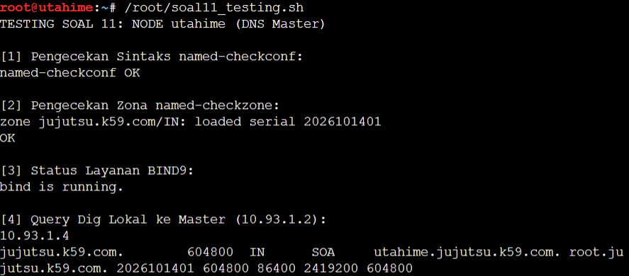<br>  

**B. Script Menaikkan Serial Number untuk Pembuktian Replikasi:**

Buat file `/root/soal11_naik_serial.sh` di **`utahime`**:

```bash
nano /root/soal11_naik_serial.sh
```

Isikan script berikut:

```bash
#!/bin/bash
echo "UJI REPLIKASI SOAL 11: MENAIKKAN SERIAL NUMBER PADA utahime"

ZONE_FILE="/etc/bind/jujutsu/db.jujutsu.k59.com"
CURRENT_SERIAL=$(grep -oE '[0-9]{10}' "$ZONE_FILE" | head -n 1)
NEW_SERIAL=$((CURRENT_SERIAL + 1))

echo "Serial saat ini : $CURRENT_SERIAL"
echo "Menaikkan ke   : $NEW_SERIAL"

sed -i "s/$CURRENT_SERIAL/$NEW_SERIAL/" "$ZONE_FILE"

echo -e "\n[1] Validasi Zona Setelah Serial Dinaikkan:"
named-checkzone jujutsu.k59.com "$ZONE_FILE"

echo -e "\n[2] Reload BIND9 Master:"
rndc reload || service bind9 reload || service named reload

echo -e "\n[3] Verifikasi SOA Baru di Master (10.93.1.2):"
dig @10.93.1.2 jujutsu.k59.com SOA +noall +answer
```

Beri izin eksekusi dan jalankan:

```bash
chmod +x /root/soal11_naik_serial.sh
/root/soal11_naik_serial.sh
```
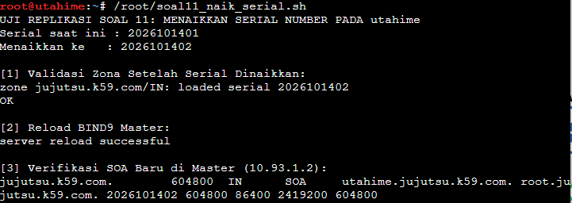 <br>  

---

#### 2. Pada Node `shoko` (DNS Slave)

Buka terminal node **`shoko`**, buat file `/root/soal11_testing.sh`:

```bash
nano /root/soal11_testing.sh
```

Isikan script berikut:

```bash
#!/bin/bash
echo "TESTING SOAL 11: NODE shoko (DNS Slave)"

echo -e "\n[1] Status Layanan BIND9:"
service named status 2>/dev/null || service bind9 status

echo -e "\n[2] Verifikasi File Replikasi Zona dari Master:"
if [ -f /var/cache/bind/db.jujutsu.k59.com ]; then
    echo "File zona berhasil disinkronisasi ke /var/cache/bind/db.jujutsu.k59.com"
    ls -l /var/cache/bind/db.jujutsu.k59.com
else
    echo "File zona belum ditemukan, memeriksa log zone transfer..."
fi

echo -e "\n[3] Query SOA ke Slave (Verifikasi Serial Tersinkronisasi):"
dig @10.93.1.3 jujutsu.k59.com SOA +noall +answer

echo -e "\n[4] Query A Record ke Slave (10.93.1.3):"
dig @10.93.1.3 jujutsu.k59.com +short
```

Beri izin eksekusi dan jalankan:

```bash
chmod +x /root/soal11_testing.sh
/root/soal11_testing.sh
```

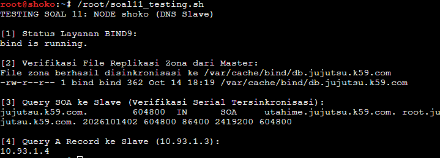<br>

---

#### 3. Pada Klien (`itadori`)

Buka terminal klien **`itadori`**, buat file `/root/soal11_testing.sh`:

```bash
nano /root/soal11_testing.sh
```

Isikan script berikut:

```bash
#!/bin/bash
echo "TESTING SOAL 11: KLIEN itadori (Uji Resolusi Domain & Replikasi)"

# Pasang bind-tools jika perintah dig belum tersedia di Alpine
if ! command -v dig &>/dev/null; then
    echo "Mengunduh paket bind-tools..."
    apk add --no-cache bind-tools 2>/dev/null || apt-get install -y dnsutils 2>/dev/null
fi

echo -e "\n[1] Query Dig Lengkap ke DNS Master utahime (10.93.1.2):"
dig @10.93.1.2 jujutsu.k59.com

echo -e "\n[2] Query Dig Lengkap ke DNS Slave shoko (10.93.1.3):"
dig @10.93.1.3 jujutsu.k59.com

echo -e "\n[3] Perbandingan Nomor Serial SOA (Master vs Slave):"
MASTER_SERIAL=$(dig @10.93.1.2 jujutsu.k59.com SOA +short | awk '{print $3}')
SLAVE_SERIAL=$(dig @10.93.1.3 jujutsu.k59.com SOA +short | awk '{print $3}')
echo "Nomor Serial pada Master (utahime): $MASTER_SERIAL"
echo "Nomor Serial pada Slave  (shoko)  : $SLAVE_SERIAL"

if [ -n "$MASTER_SERIAL" ] && [ "$MASTER_SERIAL" = "$SLAVE_SERIAL" ]; then
    echo "Status: SINKRON SEMPURNA (Kedua server memiliki nomor serial identik)"
else
    echo "Status: BELUM SINKRON (Menunggu transfer zona selesai)"
fi
```

Beri izin eksekusi dan jalankan:

```bash
chmod +x /root/soal11_testing.sh
/root/soal11_testing.sh
```
 
 <br>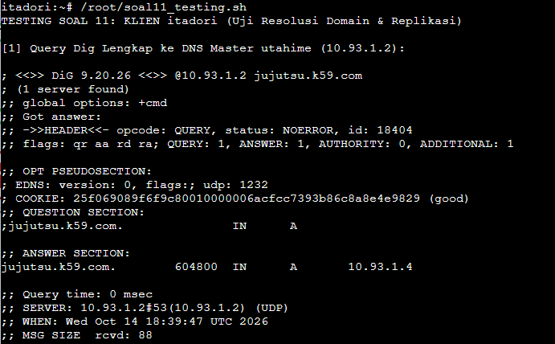
 <br>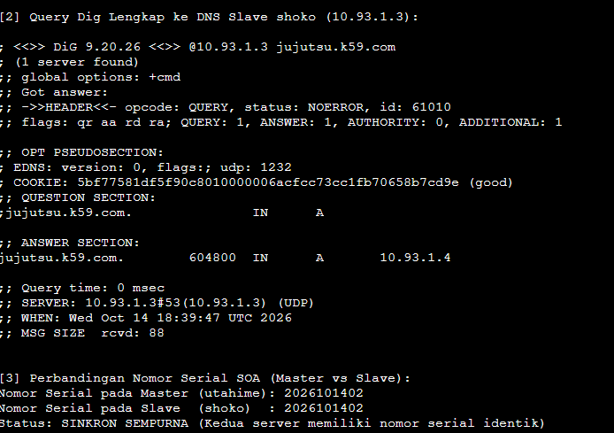
 ---

## Soal 12
### Perintah soal
Mengembangkan peta domain resmi Jujutsu High dan mengaktifkan akses resolusi internet:
1. **A Record & CNAME:** Menetapkan A record `jujutsu.k59.com` mengarah ke reverse proxy `gojo` (`10.93.1.4`) dan membuat alias CNAME `www.jujutsu.k59.com` yang merujuk ke domain utama.
2. **Reverse DNS (Zona PTR):** Membuat zona reverse `1.93.10.in-addr.arpa` pada `utahime` untuk memetakan IP `10.93.1.4` (`gojo`) kembali ke domain `jujutsu.k59.com`.
3. **DNS Forwarder:** Mengonfigurasi fitur forwarder pada BIND9 yang mengarah ke gateway internet (`192.168.122.1`), sehingga seluruh permintaan resolusi domain eksternal dapat dijawab.
4. **Validasi & Pembuktian:** Menguji resolusi CNAME, query PTR (-x), resolusi domain publik (`google.com`), dan pembuktian ping internet dari terminal klien (`itadori`).

---

### Penempatan Script pada Node

| Node | File Script | Fungsi |
|---|---|---|
| **`utahime`** | `/root/soal12.sh` | Konfigurasi A record, CNAME `www`, pembuatan zona Reverse DNS PTR `1.93.10.in-addr.arpa`, konfigurasi forwarder `192.168.122.1`, dan reload BIND9 |
| **`shoko`** | `/root/soal12.sh` | Konfigurasi zona slave untuk Reverse DNS `1.93.10.in-addr.arpa`, forwarder `192.168.122.1`, dan reload BIND9 |
| **Klien (`itadori`)** | `/root/soal12_testing.sh` | Pengujian query CNAME, query PTR IP `10.93.1.4`, resolusi domain luar via forwarder, dan pengujian ping ke domain internet |

---

### Langkah Pengerjaan

#### 1. Pada Node `utahime` (DNS Master)

Buka terminal node **`utahime`**, buat file `/root/soal12.sh`:

```bash
nano /root/soal12.sh
```

Isikan script berikut:

```bash
#!/bin/bash

# 1. Konfigurasi named.conf.options dengan DNS Forwarder ke gateway internet
cat << 'EOF' > /etc/bind/named.conf.options
options {
    directory "/var/cache/bind";
    auth-nxdomain no;
    listen-on { any; };
    listen-on-v6 { none; };
    allow-query { any; };
    dnssec-validation no;

    // DNS Forwarder ke IP gateway NAT internet
    forwarders {
        192.168.122.1;
    };
};
EOF

# 2. Perbarui named.conf.local untuk menambahkan Zona Reverse PTR
cat << 'EOF' > /etc/bind/named.conf.local
// Zona Forward jujutsu.k59.com
zone "jujutsu.k59.com" {
    type master;
    file "/etc/bind/jujutsu/db.jujutsu.k59.com";
    allow-transfer { 10.93.1.3; };
    also-notify { 10.93.1.3; };
};

// Zona Reverse untuk subnet 10.93.1.0/24 (DMZ)
zone "1.93.10.in-addr.arpa" {
    type master;
    file "/etc/bind/jujutsu/db.1.93.10.in-addr.arpa";
    allow-transfer { 10.93.1.3; };
    also-notify { 10.93.1.3; };
};
EOF

# 3. Perbarui Zona Forward: Tambahkan A Record gojo dan CNAME www
cat << 'EOF' > /etc/bind/jujutsu/db.jujutsu.k59.com
;
; BIND data file for jujutsu.k59.com
;
$TTL    604800
@       IN      SOA     utahime.jujutsu.k59.com. root.jujutsu.k59.com. (
                              2026101403 ; Serial
                                  604800 ; Refresh
                                   86400 ; Retry
                                 2419200 ; Expire
                                  604800 ) ; Negative Cache TTL
;
@       IN      NS      utahime.jujutsu.k59.com.
@       IN      NS      shoko.jujutsu.k59.com.

; A Record untuk Name Server
utahime IN      A       10.93.1.2
shoko   IN      A       10.93.1.3

; Domain Utama (mengarah ke gojo - Public Reverse Proxy)
@       IN      A       10.93.1.4
gojo    IN      A       10.93.1.4

; CNAME www merujuk ke domain utama jujutsu.k59.com
www     IN      CNAME   jujutsu.k59.com.
EOF

# 4. Buat File Database Zona Reverse DNS (PTR)
cat << 'EOF' > /etc/bind/jujutsu/db.1.93.10.in-addr.arpa
;
; BIND reverse data file for 10.93.1.0/24
;
$TTL    604800
@       IN      SOA     utahime.jujutsu.k59.com. root.jujutsu.k59.com. (
                              2026101401 ; Serial
                                  604800 ; Refresh
                                   86400 ; Retry
                                 2419200 ; Expire
                                  604800 ) ; Negative Cache TTL
;
@       IN      NS      utahime.jujutsu.k59.com.
@       IN      NS      shoko.jujutsu.k59.com.

; PTR Record: 10.93.1.4 -> jujutsu.k59.com
4       IN      PTR     jujutsu.k59.com.
EOF

# 5. Validasi konfigurasi sintaks dan zona
named-checkconf
named-checkzone jujutsu.k59.com /etc/bind/jujutsu/db.jujutsu.k59.com
named-checkzone 1.93.10.in-addr.arpa /etc/bind/jujutsu/db.1.93.10.in-addr.arpa

# 6. Reload layanan BIND9
rndc reload || service named restart || service bind9 restart
service named status || service bind9 status
```

Beri izin eksekusi dan jalankan:

```bash
chmod +x /root/soal12.sh
/root/soal12.sh
```

---

#### 2. Pada Node `shoko` (DNS Slave)

Buka terminal node **`shoko`**, buat file `/root/soal12.sh`:

```bash
nano /root/soal12.sh
```

Isikan script berikut:

```bash
#!/bin/bash

# 1. Konfigurasi named.conf.options dengan DNS Forwarder ke gateway internet
cat << 'EOF' > /etc/bind/named.conf.options
options {
    directory "/var/cache/bind";
    auth-nxdomain no;
    listen-on { any; };
    listen-on-v6 { none; };
    allow-query { any; };
    dnssec-validation no;

    forwarders {
        192.168.122.1;
    };
};
EOF

# 2. Konfigurasi named.conf.local (Zona Slave Forward & Reverse)
cat << 'EOF' > /etc/bind/named.conf.local
zone "jujutsu.k59.com" {
    type slave;
    file "/var/cache/bind/db.jujutsu.k59.com";
    masters { 10.93.1.2; };
};

zone "1.93.10.in-addr.arpa" {
    type slave;
    file "/var/cache/bind/db.1.93.10.in-addr.arpa";
    masters { 10.93.1.2; };
};
EOF

# 3. Validasi konfigurasi
named-checkconf

# 4. Reload layanan BIND9
rndc reload || service named restart || service bind9 restart
service named status || service bind9 status
```

Beri izin eksekusi dan jalankan:

```bash
chmod +x /root/soal12.sh
/root/soal12.sh
```

---

### Script Testing

#### Pada Klien (`itadori`)

Buka terminal klien **`itadori`**, buat file `/root/soal12_testing.sh`:

```bash
nano /root/soal12_testing.sh
```

Isikan script berikut:

```bash
#!/bin/bash
echo "TESTING SOAL 12: KLIEN $(hostname) (CNAME, PTR, & DNS FORWARDER)"

# Pastikan bind-tools terpasang
if ! command -v dig &>/dev/null; then
    apk add --no-cache bind-tools 2>/dev/null || apt-get install -y dnsutils 2>/dev/null
fi

echo -e "\n[1] Pengujian CNAME www.jujutsu.k59.com:"
dig @10.93.1.2 www.jujutsu.k59.com +noall +answer

echo -e "\n[2] Pengujian Reverse DNS (PTR) untuk IP 10.93.1.4 (gojo):"
dig @10.93.1.2 -x 10.93.1.4 +noall +answer

echo -e "\n[3] Pengujian DNS Forwarder ke Internet via DNS Master (google.com):"
dig @10.93.1.2 google.com +short

echo -e "\n[4] Pengujian Ping ke Domain Internet (google.com):"
echo "nameserver 10.93.1.2" > /etc/resolv.conf
ping -c 3 google.com
```

Beri izin eksekusi dan jalankan:

```bash
chmod +x /root/soal12_testing.sh
/root/soal12_testing.sh
```
 
 ---

## Soal 13
### Perintah soal
Membangun klaster database terpusat yang redundan menggunakan MariaDB Replikasi Master-Slave:
1. **Konfigurasi DB Master (`yaga` - `10.93.4.8`):** Mengaktifkan binary logging (`log-bin`), menetapkan `server-id = 1`, mendengarkan pada semua interface (`bind-address = 0.0.0.0`), dan membuat user replikasi.
2. **Inisialisasi Database & Skema:** Membuat database `db_shibuya_k59` dan tabel `request_logs` di Master, serta memberikan hak akses remote bagi seluruh node di Network 4 (`10.93.4.%`).
3. **Konfigurasi DB Slave (`inumaki` - `10.93.4.9`):** Menetapkan `server-id = 2`, menghubungkan slave ke master secara realtime menggunakan `CHANGE MASTER TO`, dan mengaktifkan proses replikasi (`START SLAVE`).
4. **Validasi & Pembuktian:** Memeriksa status replikasi (`Slave_IO_Running: Yes`, `Slave_SQL_Running: Yes`), memasukkan data baru di Master, dan memverifikasi data tersebut langsung tersinkronisasi secara realtime di Slave.

---

### Penempatan Script pada Node

| Node | File Script | Fungsi |
|---|---|---|
| **`yaga`** | `/root/soal13.sh` | Konfigurasi IP statis, instalasi MariaDB Server, konfigurasi `server-id = 1` & `log-bin`, inisialisasi database `db_shibuya_k59`, tabel `request_logs`, user replikasi, dan hak akses remote Network 4 |
| **`inumaki`** | `/root/soal13.sh` | Konfigurasi IP statis, instalasi MariaDB Server, konfigurasi `server-id = 2`, penarikan posisi log master, dan inisialisasi slave replikasi |
| **`yaga`** | `/root/soal13_testing.sh` | Menampilkan status master (`SHOW MASTER STATUS`) dan memasukkan data log uji coba ke tabel `request_logs` |
| **`inumaki`** | `/root/soal13_testing.sh` | Memverifikasi status replikasi (`SHOW SLAVE STATUS`) dan menampilkan data yang berhasil disalin dari master |

---

### Langkah Pengerjaan

#### 1. Pada Node `yaga` (DB Master)

Buka terminal node **`yaga`**, buat file `/root/soal13.sh`:  

Jalanin ini di terminal yaga  

```
mariadb -u root -e "CREATE USER IF NOT EXISTS 'jujutsu_user'@'10.93.4.%' IDENTIFIED BY 'password123'; GRANT ALL PRIVILEGES ON db_shibuya_k59.* TO 'jujutsu_user'@'10.93.4.%'; FLUSH PRIVILEGES;"
```

```bash
nano /root/soal13.sh
```

Isikan script berikut:

```bash
#!/bin/bash

# 1. Atur IP statis yaga dan nameserver untuk instalasi paket
ip addr flush dev eth0 2>/dev/null || true
ip addr add 10.93.4.8/24 dev eth0
ip link set eth0 up
ip route replace default via 10.93.4.1 dev eth0 2>/dev/null || true
echo "nameserver 192.168.122.1" > /etc/resolv.conf

# 2. Instalasi paket MariaDB Server & Client
apt-get update -y
apt-get install -y mariadb-server mariadb-client

# Buat direktori log jika diperlukan
mkdir -p /var/log/mysql
chown -R mysql:mysql /var/log/mysql

# 3. Konfigurasi MariaDB Master (bind-address, server-id, binary logging)
cat << 'EOF' > /etc/mysql/mariadb.conf.d/50-server.cnf
[server]

[mysqld]
user                    = mysql
pid-file                = /run/mysqld/mysqld.pid
basedir                 = /usr
datadir                 = /var/lib/mysql
tmpdir                  = /tmp
lc-messages-dir         = /usr/share/mysql

# Buka akses agar mendengarkan di seluruh interface jaringan
bind-address            = 0.0.0.0

# Konfigurasi Binary Logging untuk Replikasi Master
server-id               = 1
log-bin                 = mariadb-bin
binlog_format           = ROW
binlog_do_db            = db_shibuya_k59
EOF

# 4. Restart layanan MariaDB
service mariadb restart
service mariadb status

# 5. Inisialisasi Database, Tabel, dan User Privilege
mariadb -u root << 'EOF'
CREATE DATABASE IF NOT EXISTS db_shibuya_k59;

USE db_shibuya_k59;

CREATE TABLE IF NOT EXISTS request_logs (
    id INT AUTO_INCREMENT PRIMARY KEY,
    worker_name VARCHAR(50) NOT NULL,
    client_ip VARCHAR(50) NOT NULL,
    proxy_ip VARCHAR(50) NOT NULL,
    user_agent TEXT,
    created_at TIMESTAMP DEFAULT CURRENT_TIMESTAMP
);

-- User untuk replikasi Slave (inumaki)
CREATE USER IF NOT EXISTS 'replica'@'%' IDENTIFIED BY 'password_replica';
GRANT REPLICATION SLAVE, REPLICATION CLIENT ON *.* TO 'replica'@'%';

-- User aplikasi untuk seluruh node di Network 4 (10.93.4.%)
CREATE USER IF NOT EXISTS 'jujutsu_user'@'10.93.4.%' IDENTIFIED BY 'password123';
GRANT ALL PRIVILEGES ON db_shibuya_k59.* TO 'jujutsu_user'@'10.93.4.%';
CREATE USER IF NOT EXISTS 'jujutsu_user'@'%' IDENTIFIED BY 'password123';
GRANT ALL PRIVILEGES ON db_shibuya_k59.* TO 'jujutsu_user'@'%';

FLUSH PRIVILEGES;
EOF

echo "Konfigurasi DB Master yaga selesai."
mariadb -u root -e "SHOW MASTER STATUS\G"
```

Beri izin eksekusi dan jalankan:

```bash
chmod +x /root/soal13.sh
/root/soal13.sh
```

---

#### 2. Pada Node `inumaki` (DB Slave)

Buka terminal node **`inumaki`**, buat file `/root/soal13.sh`:

```bash
nano /root/soal13.sh
```

Isikan script berikut:

```bash
#!/bin/bash

# 1. Atur IP statis inumaki dan nameserver untuk instalasi paket
ip addr flush dev eth0 2>/dev/null || true
ip addr add 10.93.4.9/24 dev eth0
ip link set eth0 up
ip route replace default via 10.93.4.1 dev eth0 2>/dev/null || true
echo "nameserver 192.168.122.1" > /etc/resolv.conf

# 2. Instalasi paket MariaDB Server & Client
apt-get update -y
apt-get install -y mariadb-server mariadb-client

# 3. Konfigurasi MariaDB Slave (bind-address, server-id)
cat << 'EOF' > /etc/mysql/mariadb.conf.d/50-server.cnf
[server]

[mysqld]
user                    = mysql
pid-file                = /run/mysqld/mysqld.pid
basedir                 = /usr
datadir                 = /var/lib/mysql
tmpdir                  = /tmp
lc-messages-dir         = /usr/share/mysql

bind-address            = 0.0.0.0

# Konfigurasi Replikasi Slave
server-id               = 2
replicate_do_db         = db_shibuya_k59
EOF

# 4. Restart layanan MariaDB
service mariadb restart
service mariadb status

# 5. Ambil posisi log dari Master yaga (10.93.4.8) secara otomatis
echo "Mengambil status binlog dari Master yaga (10.93.4.8)..."
MASTER_STATUS=$(mariadb -h 10.93.4.8 -u replica -ppassword_replica -e "SHOW MASTER STATUS\G" 2>/dev/null)
LOG_FILE=$(echo "$MASTER_STATUS" | grep -i "File:" | awk '{print $2}')
LOG_POS=$(echo "$MASTER_STATUS" | grep -i "Position:" | awk '{print $2}')

if [ -z "$LOG_FILE" ] || [ -z "$LOG_POS" ]; then
    echo "Peringatan: Gagal mengambil binlog otomatis. Menggunakan default posisi awal."
    LOG_FILE="mariadb-bin.000001"
    LOG_POS=4
fi

echo "Master Log File: $LOG_FILE"
echo "Master Log Position: $LOG_POS"

# 6. Hubungkan Slave ke Master yaga
mariadb -u root << EOF
STOP SLAVE;
CHANGE MASTER TO
    MASTER_HOST='10.93.4.8',
    MASTER_USER='replica',
    MASTER_PASSWORD='password_replica',
    MASTER_PORT=3306,
    MASTER_LOG_FILE='$LOG_FILE',
    MASTER_LOG_POS=$LOG_POS,
    MASTER_CONNECT_RETRY=10;
START SLAVE;
EOF

echo "Konfigurasi DB Slave inumaki selesai."
```

Beri izin eksekusi dan jalankan:

```bash
chmod +x /root/soal13.sh
/root/soal13.sh
```

---

### Script Testing (Pembuktian Replikasi)

#### 1. Pada Node `inumaki` (Cek Status Slave)

Buka terminal node **`inumaki`**, buat file `/root/soal13_testing.sh`:

```bash
nano /root/soal13_testing.sh
```

Isikan script berikut:

```bash
#!/bin/bash
echo "TESTING SOAL 13: NODE inumaki (Status Replikasi Slave)"

echo -e "\n[1] Pengecekan Status Replikasi (Slave_IO & Slave_SQL):"
mariadb -u root -e "SHOW SLAVE STATUS\G" | grep -E "Slave_IO_Running|Slave_SQL_Running|Seconds_Behind_Master|Last_IO_Error|Last_SQL_Error"

echo -e "\n[2] Isi Tabel request_logs Saat Ini pada inumaki (Slave):"
mariadb -u root -e "SELECT * FROM db_shibuya_k59.request_logs;" 2>/dev/null || echo "Tabel belum ada atau belum tersinkronisasi."
```

Beri izin eksekusi dan jalankan:

```bash
chmod +x /root/soal13_testing.sh
/root/soal13_testing.sh
```

---

#### 2. Pada Node `yaga` (Uji Penambahan Data di Master)

Buka terminal node **`yaga`**, buat file `/root/soal13_testing.sh`:

```bash
nano /root/soal13_testing.sh
```

Isikan script berikut:

```bash
#!/bin/bash
echo "TESTING SOAL 13: NODE yaga (Penambahan Data di Master)"

echo -e "\n[1] Menambahkan Data Log Uji Coba ke Master (yaga):"
mariadb -u root db_shibuya_k59 << 'EOF'
INSERT INTO request_logs (worker_name, client_ip, proxy_ip, user_agent)
VALUES ('yaga_master_test', '10.93.2.11', '10.93.1.4', 'Testing MariaDB Master-Slave Shibuya');
EOF

echo "Data berhasil dimasukkan ke Master."

echo -e "\n[2] Isi Tabel request_logs pada yaga (Master):"
mariadb -u root -e "SELECT * FROM db_shibuya_k59.request_logs;"
```

Beri izin eksekusi dan jalankan:

```bash
chmod +x /root/soal13_testing.sh
/root/soal13_testing.sh
```

---

#### 3. Verifikasi Akhir pada `inumaki` (Slave)

Setelah data berhasil ditambahkan di `yaga`, jalankan kembali script testing di terminal **`inumaki`**:

```bash
/root/soal13_testing.sh
```

**Kriteria keberhasilan:**
1. `Slave_IO_Running: Yes` dan `Slave_SQL_Running: Yes`.
2. Data baris `'yaga_master_test'` yang baru dimasukkan di `yaga` langsung muncul di tabel `request_logs` milik `inumaki`.
 
 ---

## Soal 14
### Perintah soal
Menyiapkan klaster backend worker di Data Center (Network 4) dengan kontrol akses ketat:
1. **Worker Frontend (`maki` - `10.93.4.3`, `panda` - `10.93.4.4`):** Memasang Nginx dan PHP-FPM untuk menyajikan web frontend yang menampilkan hostname masing-masing. Akses dibatasi hanya menerima trafik dari public reverse proxy `gojo` (`10.93.1.4`), sedangkan akses langsung dari luar ditolak.
2. **Worker API (`nanami` - `10.93.4.5`, `todo` - `10.93.4.6`, `kirara` - `10.93.4.7`):** Memasang Nginx, PHP-FPM, dan driver `php-mysqli` untuk melayani API yang secara otomatis mencatat log request ke database `yaga` (`10.93.4.8`). Akses dibatasi hanya menerima trafik dari internal load balancer `geto` (`10.93.4.2`).
3. **Validasi & Pembuktian:** Membuktikan bahwa akses HTTP langsung dari klien (`itadori`) ke IP worker menghasilkan error `403 Forbidden`, sedangkan akses dari jalur proxy yang ditentukan berhasil memperoleh respons `200 OK`.

---

### Penempatan Script pada Node

| Node | File Script | Fungsi |
|---|---|---|
| **`maki` & `panda`** | `/root/soal14.sh` | Konfigurasi IP statis, instalasi Nginx & PHP-FPM, script web frontend penampil hostname, dan restriksi akses (hanya allow `10.93.1.4`) |
| **`nanami`, `todo`, `kirara`** | `/root/soal14.sh` | Konfigurasi IP statis, instalasi Nginx, PHP-FPM & `php-mysqli`, script API pencatat log ke DB `yaga`, dan restriksi akses (hanya allow `10.93.4.2`) |
| **Klien (`itadori`)** | `/root/soal14_testing.sh` | Pengujian akses langsung dari klien ke worker frontend & API untuk membuktikan respons ditolak (`403 Forbidden`) |
| **`gojo` & `geto`** | `/root/soal14_testing.sh` | Pengujian akses dari proxy resmi untuk membuktikan respons diizinkan (`200 OK`) |

---

### Langkah Pengerjaan

#### 1. Pada Node Worker Frontend (`maki` & `panda`)

Buka terminal node **`maki`** atau **`panda`**, buat file `/root/soal14.sh`:

```bash
nano /root/soal14.sh
```

Isikan script berikut (script akan otomatis menyesuaikan IP berdasarkan hostname):

```bash
#!/bin/bash
NODE_NAME="$(hostname)"

# 1. Atur IP statis berdasarkan hostname
case "$NODE_NAME" in
    maki)
        NODE_IP="10.93.4.3"
        ;;
    panda)
        NODE_IP="10.93.4.4"
        ;;
    *)
        echo "Nama node tidak dikenal: $NODE_NAME"
        exit 1
        ;;
esac

ip addr flush dev eth0 2>/dev/null || true
ip addr add ${NODE_IP}/24 dev eth0
ip link set eth0 up
ip route replace default via 10.93.4.1 dev eth0 2>/dev/null || true
echo "nameserver 192.168.122.1" > /etc/resolv.conf

# 2. Instalasi Nginx dan PHP-FPM
apt-get update -y
apt-get install -y nginx php-fpm

# 3. Deteksi versi PHP dan pastikan socket PHP-FPM aktif
PHP_VERSION=$(php -v 2>/dev/null | head -n 1 | cut -d " " -f 2 | cut -d "." -f 1,2)
[ -z "$PHP_VERSION" ] && PHP_VERSION="8.4"
PHP_SOCK="/run/php/php${PHP_VERSION}-fpm.sock"

service "php${PHP_VERSION}-fpm" start 2>/dev/null || service php-fpm start 2>/dev/null

# 4. Buat Script Web Frontend
cat << 'EOF' > /var/www/html/index.php
<?php
$hostname = gethostname();
echo "Hello from Frontend Worker: " . $hostname . "\n";
?>
EOF
chown -R www-data:www-data /var/www/html

# 5. Konfigurasi Virtual Host Nginx dengan Access Restriction
# Hanya mengizinkan akses dari gojo (10.93.1.4) dan localhost
cat << EOF > /etc/nginx/sites-available/default
server {
    listen 80 default_server;
    listen [::]:80 default_server;

    root /var/www/html;
    index index.php index.html;
    server_name jujutsu.k59.com www.jujutsu.k59.com _;

    # Access Control: Hanya izinkan proxy gojo (10.93.1.4)
    allow 10.93.1.4;
    allow 127.0.0.1;
    deny all;

    location / {
        try_files \$uri \$uri/ /index.php?\$query_string;
    }

    location ~ \.php$ {
        include snippets/fastcgi-php.conf;
        fastcgi_pass unix:${PHP_SOCK};
    }
}
EOF

# 6. Validasi dan jalankan service
nginx -t
service nginx restart
service "php${PHP_VERSION}-fpm" restart 2>/dev/null || service php-fpm restart 2>/dev/null
echo "Setup Frontend Worker $NODE_NAME (${NODE_IP}) selesai."
```

Beri izin eksekusi dan jalankan pada **`maki`** dan **`panda`**:

```bash
chmod +x /root/soal14.sh
bash /root/soal14.sh
```

---

#### 2. Pada Node Worker API (`nanami`, `todo`, `kirara`)

Buka terminal node **`nanami`**, **`todo`**, atau **`kirara`**, buat file `/root/soal14.sh`:

```bash
nano /root/soal14.sh
```

Isikan script berikut:

```bash
#!/bin/bash
NODE_NAME="$(hostname)"

# 1. Atur IP statis berdasarkan hostname
case "$NODE_NAME" in
    nanami)
        NODE_IP="10.93.4.5"
        ;;
    todo)
        NODE_IP="10.93.4.6"
        ;;
    kirara)
        NODE_IP="10.93.4.7"
        ;;
    *)
        echo "Nama node tidak dikenal: $NODE_NAME"
        exit 1
        ;;
esac

ip addr flush dev eth0 2>/dev/null || true
ip addr add ${NODE_IP}/24 dev eth0
ip link set eth0 up
ip route replace default via 10.93.4.1 dev eth0 2>/dev/null || true
echo "nameserver 192.168.122.1" > /etc/resolv.conf

# 2. Instalasi Nginx, PHP-FPM, php-mysqli, dan mariadb-client
apt-get update -y
apt-get install -y nginx php-fpm php-mysqli mariadb-client

# 3. Deteksi versi PHP dan pastikan socket PHP-FPM aktif
PHP_VERSION=$(php -v 2>/dev/null | head -n 1 | cut -d " " -f 2 | cut -d "." -f 1,2)
[ -z "$PHP_VERSION" ] && PHP_VERSION="8.4"
PHP_SOCK="/run/php/php${PHP_VERSION}-fpm.sock"

service "php${PHP_VERSION}-fpm" start 2>/dev/null || service php-fpm start 2>/dev/null

# 4. Buat Script API yang mencatat log request ke Database yaga (10.93.4.8)
cat << 'EOF' > /var/www/html/index.php
<?php
header('Content-Type: application/json; charset=utf-8');

$worker = gethostname();
$client_ip = isset($_SERVER['HTTP_X_REAL_IP']) ? $_SERVER['HTTP_X_REAL_IP'] : 
             (isset($_SERVER['HTTP_X_FORWARDED_FOR']) ? $_SERVER['HTTP_X_FORWARDED_FOR'] : $_SERVER['REMOTE_ADDR']);
$proxy_ip = $_SERVER['REMOTE_ADDR'];
$user_agent = isset($_SERVER['HTTP_USER_AGENT']) ? $_SERVER['HTTP_USER_AGENT'] : 'Unknown';

$conn = new mysqli('10.93.4.8', 'jujutsu_user', 'password123', 'db_shibuya_k59');
if ($conn->connect_error) {
    http_response_code(500);
    echo json_encode(["status" => "error", "message" => "Database connection failed"]);
    exit;
}

$stmt = $conn->prepare("INSERT INTO request_logs (worker_name, client_ip, proxy_ip, user_agent) VALUES (?, ?, ?, ?)");
if ($stmt) {
    $stmt->bind_param("ssss", $worker, $client_ip, $proxy_ip, $user_agent);
    $stmt->execute();
    $stmt->close();
}
$conn->close();

echo json_encode([
    "status" => "success",
    "worker" => $worker,
    "client_ip" => $client_ip,
    "proxy_ip" => $proxy_ip,
    "message" => "Request logged successfully to yaga"
]) . "\n";
?>
EOF
chown -R www-data:www-data /var/www/html

# 5. Konfigurasi Virtual Host Nginx dengan Access Restriction
# Hanya mengizinkan akses dari load balancer geto (10.93.4.2) dan localhost
cat << EOF > /etc/nginx/sites-available/default
server {
    listen 80 default_server;
    listen [::]:80 default_server;

    root /var/www/html;
    index index.php index.html;
    server_name jujutsu.k59.com www.jujutsu.k59.com _;

    # Access Control: Hanya izinkan internal load balancer geto (10.93.4.2)
    allow 10.93.4.2;
    allow 127.0.0.1;
    deny all;

    location / {
        try_files \$uri \$uri/ /index.php?\$query_string;
    }

    location ~ \.php$ {
        include snippets/fastcgi-php.conf;
        fastcgi_pass unix:${PHP_SOCK};
    }
}
EOF

# 6. Validasi dan jalankan service
nginx -t
service nginx restart
service "php${PHP_VERSION}-fpm" restart 2>/dev/null || service php-fpm restart 2>/dev/null
echo "Setup API Worker $NODE_NAME (${NODE_IP}) selesai."
```

Beri izin eksekusi dan jalankan pada **`nanami`**, **`todo`**, dan **`kirara`**:

```bash
chmod +x /root/soal14.sh
/root/soal14.sh
```

---

### Script Testing (Pembuktian Sesuai Soal)

#### 1. Uji Akses Langsung dari Klien (`itadori`) -> HARUS DITOLAK (403 Forbidden)

Buka terminal klien **`itadori`**, buat file `/root/soal14_testing.sh`:

```bash
nano /root/soal14_testing.sh
```

Isikan script berikut:

```bash
#!/bin/bash
echo "TESTING SOAL 14: KLIEN itadori (Uji Akses Langsung ke Worker)"

echo -e "\n[1] Akses Langsung ke Frontend Worker maki (10.93.4.3):"
curl -I http://10.93.4.3/ | head -n 5

echo -e "\n[2] Akses Langsung ke Frontend Worker panda (10.93.4.4):"
curl -I http://10.93.4.4/ | head -n 5

echo -e "\n[3] Akses Langsung ke API Worker nanami (10.93.4.5):"
curl -I http://10.93.4.5/ | head -n 5

echo -e "\n[4] Akses Langsung ke API Worker todo (10.93.4.6):"
curl -I http://10.93.4.6/ | head -n 5

echo -e "\n[5] Akses Langsung ke API Worker kirara (10.93.4.7):"
curl -I http://10.93.4.7/ | head -n 5
```

Beri izin eksekusi dan jalankan:

```bash
chmod +x /root/soal14_testing.sh
/root/soal14_testing.sh
```

*(Kriteria sukses: Seluruh request langsung dari klien harus menampilkan status **`HTTP/1.1 403 Forbidden`**).*

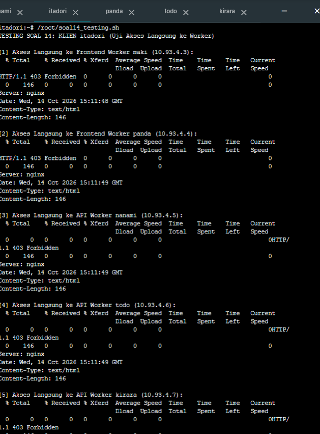
---

#### 2. Uji Akses Melalui Jalur Proxy Resmi -> HARUS DISETUJUI (200 OK)

**A. Dari node `gojo` (`10.93.1.4`) ke Frontend Worker:**  
Buka terminal **`gojo`**, jalankan:
```bash
echo -e "\n=== UJI AKSES GOJO -> MAKI ==="
curl http://10.93.4.3/

echo -e "\n=== UJI AKSES GOJO -> PANDA ==="
curl http://10.93.4.4/
```
*(Kriteria sukses: Menampilkan respons `Hello from Frontend Worker: maki` dan `Hello from Frontend Worker: panda` dengan status HTTP 200).*

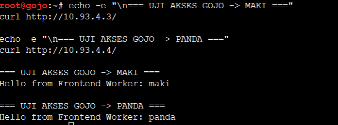

**B. Dari node `geto` (`10.93.4.2`) ke API Worker:**  
Buka terminal **`geto`**, pastikan IP `10.93.4.2` terpasang lalu jalankan:
```bash
ip addr add 10.93.4.2/24 dev eth0 2>/dev/null; ip link set eth0 up

echo -e "\n=== UJI AKSES GETO -> NANAMI ==="
curl http://10.93.4.5/

echo -e "\n=== UJI AKSES GETO -> TODO ==="
curl http://10.93.4.6/

echo -e "\n=== UJI AKSES GETO -> KIRARA ==="
curl http://10.93.4.7/
```
*(Kriteria sukses: Menampilkan respons JSON status success dari masing-masing worker dan data log tersimpan di database `yaga`).*
 
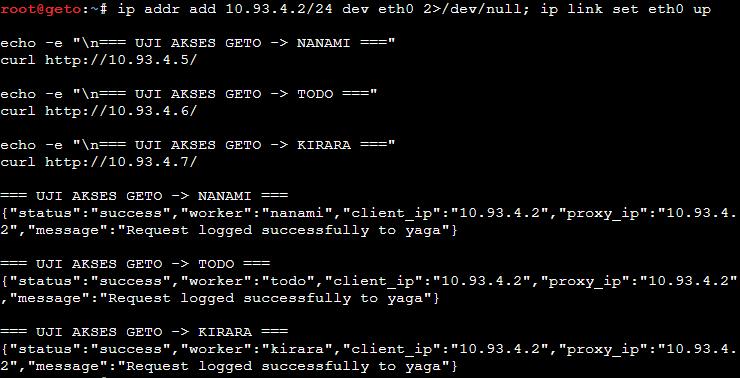

 ---

## Soal 15
### Perintah soal
Mengonfigurasi Nginx pada `geto` (`10.93.4.2`) sebagai Internal Load Balancer untuk mengendalikan pembagian beban request API di Data Center:
1. **Upstream Cluster:** Membuat grup upstream `api_cluster` yang beranggotakan worker API utama: `nanami` (`10.93.4.5:80`) dan `todo` (`10.93.4.6:80`).
2. **Algoritma Weighted Round Robin (3:1):** Menerapkan parameter `weight=3` untuk `nanami` dan `weight=1` untuk `todo`, sehingga `nanami` menerima porsi beban 3 kali lebih banyak (75%) dibanding `todo` (25%).
3. **Validasi & Pembuktian:** Melakukan loop request berulang kali (40 kali) ke `geto` dari jaringan lokal Data Center, lalu menghitung distribusi respons untuk membuktikan rasio beban 3:1 antara `nanami` dan `todo`.

---

### Penempatan Script pada Node

| Node | File Script | Fungsi |
|---|---|---|
| **`geto`** | `/root/soal15.sh` | Konfigurasi IP statis, instalasi Nginx, pembuatan vhost load balancer dengan upstream `api_cluster` berbobot 3:1, dan reload Nginx |
| **`geto` / `tengen`** | `/root/soal15_testing.sh` | Mengirimkan 40 request secara beruntun ke `http://10.93.4.2/` dan menghitung rasio distribusi respons dari `nanami` vs `todo` |

---

### Langkah Pengerjaan

#### Pada Node `geto` (Internal Load Balancer)

Buka terminal node **`geto`**, buat file `/root/soal15.sh`:

```bash
nano /root/soal15.sh
```

Isikan script berikut:

```bash
#!/bin/bash

# 1. Atur IP statis geto dan nameserver untuk instalasi paket
ip addr flush dev eth0 2>/dev/null || true
ip addr add 10.93.4.2/24 dev eth0
ip link set eth0 up
ip route replace default via 10.93.4.1 dev eth0 2>/dev/null || true
echo "nameserver 192.168.122.1" > /etc/resolv.conf

# 2. Instalasi Nginx dan curl
apt-get update -y
apt-get install -y nginx curl

# 3. Konfigurasi Upstream Weighted Round Robin 3:1
cat << 'EOF' > /etc/nginx/sites-available/load-balancer.conf
upstream api_cluster {
    server 10.93.4.5:80 weight=3; # nanami (menerima 3 dari setiap 4 request)
    server 10.93.4.6:80 weight=1; # todo   (menerima 1 dari setiap 4 request)
}

server {
    listen 80 default_server;
    listen [::]:80 default_server;
    server_name _;

    location / {
        proxy_pass http://api_cluster;
        proxy_set_header Host $host;
        proxy_set_header X-Real-IP $remote_addr;
        proxy_set_header X-Forwarded-For $proxy_add_x_forwarded_for;
        proxy_set_header X-Forwarded-Proto $scheme;
    }
}
EOF

# 4. Aktifkan konfigurasi load balancer dan nonaktifkan default site
ln -sf /etc/nginx/sites-available/load-balancer.conf /etc/nginx/sites-enabled/
rm -f /etc/nginx/sites-enabled/default

# 5. Validasi sintaks dan jalankan service
nginx -t
service nginx restart
service nginx status

echo "Konfigurasi Load Balancer geto selesai."
```

Beri izin eksekusi dan jalankan:

```bash
chmod +x /root/soal15.sh
/root/soal15.sh
```

---

### Script Testing (Pembuktian Rasio Beban 3:1)

Buka terminal node **`geto`** (atau node lokal Network 4 seperti **`tengen`**), buat file `/root/soal15_testing.sh`:

```bash
nano /root/soal15_testing.sh
```

Isikan script berikut:

```bash
#!/bin/bash
echo "TESTING SOAL 15: Uji Distribusi Beban Weighted Round Robin (3:1)"
echo "Mengirimkan 40 request secara berurutan ke geto (10.93.4.2)..."

for i in $(seq 1 40); do
    curl -s http://10.93.4.2/ | grep -o '"worker":"[^"]*"' | cut -d '"' -f 4
done | sort | uniq -c

echo -e "\nTarget Distribusi yang Diharapkan (Rasio 3:1):"
echo "  30 nanami (75%)"
echo "  10 todo   (25%)"
```

Beri izin eksekusi dan jalankan:

```bash
chmod +x /root/soal15_testing.sh
/root/soal15_testing.sh
```

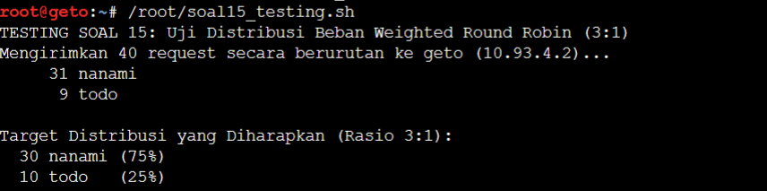<br>

 ---

## Soal 16
### Perintah soal
Mengonfigurasi Nginx pada node `gojo` (`10.93.1.4`) sebagai Public Reverse Proxy di perbatasan DMZ:
1. **Domain Virtual Host:** Melayani domain resmi `jujutsu.k59.com` dan alias `www.jujutsu.k59.com`.
2. **Path-Based Routing:**
   - **Root Path (`/`):** Meneruskan lalu lintas web utama secara Round Robin ke frontend worker (`maki` - `10.93.4.3:80` dan `panda` - `10.93.4.4:80`).
   - **API Path (`/api`):** Meneruskan request API langsung ke internal load balancer `geto` (`10.93.4.2:80`).
3. **Validasi & Pembuktian:** Menguji dari klien Divisi A (`itadori`) bahwa akses root (`/`) dijawab bergantian oleh `maki` dan `panda`, sedangkan endpoint `/api` dijawab oleh `nanami` atau `todo` via `geto`.

---

### Penempatan Script pada Node

| Node | File Script | Fungsi |
|---|---|---|
| **`gojo`** | `/root/soal16.sh` | Konfigurasi IP statis, instalasi Nginx, pengaturan upstream, Path-Based Routing (`/` dan `/api`), serta reload Nginx |
| **`itadori`** | `/root/soal16_testing.sh` | Menguji akses web root (`/`) dan endpoint `/api` dari klien menggunakan domain resmi |

---

### Langkah Pengerjaan

#### Pada Node `gojo` (Public Reverse Proxy)

Buka terminal node **`gojo`**, buat file `/root/soal16.sh`:

```bash
nano /root/soal16.sh
```

Isikan script berikut:

```bash
#!/bin/bash

# 1. Atur IP statis gojo dan nameserver untuk instalasi paket
ip addr flush dev eth0 2>/dev/null || true
ip addr add 10.93.1.4/24 dev eth0
ip link set eth0 up
ip route replace default via 10.93.1.1 dev eth0 2>/dev/null || true
echo "nameserver 192.168.122.1" > /etc/resolv.conf

# 2. Instalasi Nginx dan curl
apt-get update -y
apt-get install -y nginx curl

# 3. Konfigurasi Upstream dan Path-Based Routing
cat << 'EOF' > /etc/nginx/sites-available/gojo-proxy.conf
# Upstream ke Frontend Worker (Round Robin)
upstream frontend_cluster {
    server 10.93.4.3:80; # maki
    server 10.93.4.4:80; # panda
}

# Upstream ke Internal Load Balancer
upstream api_gateway {
    server 10.93.4.2:80; # geto
}

server {
    listen 80 default_server;
    listen [::]:80 default_server;
    server_name jujutsu.k59.com www.jujutsu.k59.com _;

    # Routing ke API Cluster melalui geto
    location /api {
        proxy_pass http://api_gateway/;
        proxy_set_header Host $host;
        proxy_set_header X-Real-IP $remote_addr;
        proxy_set_header X-Forwarded-For $proxy_add_x_forwarded_for;
        proxy_set_header X-Forwarded-Proto $scheme;
    }

    # Routing ke Frontend Worker
    location / {
        proxy_pass http://frontend_cluster;
        proxy_set_header Host $host;
        proxy_set_header X-Real-IP $remote_addr;
        proxy_set_header X-Forwarded-For $proxy_add_x_forwarded_for;
        proxy_set_header X-Forwarded-Proto $scheme;
    }
}
EOF

# 4. Aktifkan konfigurasi proxy dan nonaktifkan default site
ln -sf /etc/nginx/sites-available/gojo-proxy.conf /etc/nginx/sites-enabled/
rm -f /etc/nginx/sites-enabled/default

# 5. Validasi sintaks dan jalankan service
nginx -t
service nginx restart
service nginx status

echo "Konfigurasi Public Reverse Proxy gojo selesai."
```

Beri izin eksekusi dan jalankan:

```bash
chmod +x /root/soal16.sh
/root/soal16.sh
```

---

### Script Testing Pembuktian

Buka terminal klien **`itadori`**, buat file `/root/soal16_testing.sh`:

```bash
nano /root/soal16_testing.sh
```

Isikan script berikut:

```bash
#!/bin/bash
echo "TESTING SOAL 16: KLIEN $(hostname) (Uji Path-Based Routing)"

# Pastikan nameserver mengarah ke DNS Master (utahime)
echo "nameserver 10.93.1.2" > /etc/resolv.conf

echo -e "\n[1] Akses Web Utama Root (/) - Target: maki / panda bergantian:"
for i in {1..4}; do
    echo -n "Request $i: "
    curl -s http://jujutsu.k59.com/
done

echo -e "\n[2] Akses Endpoint API (/api) - Target: nanami / todo via geto:"
for i in {1..4}; do
    echo -n "Request $i: "
    curl -s http://jujutsu.k59.com/api | grep -o '"worker":"[^"]*"'
done
```

Beri izin eksekusi dan jalankan di **`itadori`**:

```bash
chmod +x /root/soal16_testing.sh
/root/soal16_testing.sh
```

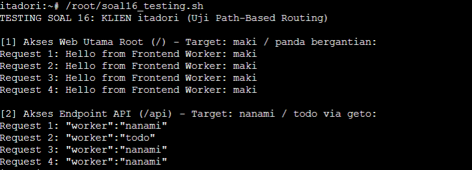

---

## Soal 17
### Perintah soal
Meneruskan dan memvalidasi alamat IP asli klien melalui rantai reverse proxy tanpa tertukar dengan IP proxy perantara:
1. **Forwarding Header pada `gojo` (`10.93.1.4`):** Mengonfigurasi Nginx agar meneruskan alamat IP asal klien menggunakan header `X-Real-IP` dan `X-Forwarded-For` saat me-route request ke path `/api`.
2. **Trusted Proxy pada `geto` (`10.93.4.2`):** Menggunakan Nginx `http_realip_module` (`set_real_ip_from 10.93.1.4; real_ip_header X-Forwarded-For; real_ip_recursive on;`) agar `geto` hanya memercayai header IP yang diteruskan oleh reverse proxy terpercaya (`gojo`), lalu meneruskan IP klien yang sudah terverifikasi ke cluster worker API (`nanami`, `todo`, `kirara`).
3. **Pencatatan ke Database `yaga`:** Skrip API pada worker backend menyimpan alamat klien yang telah divalidasi ke kolom `client_ip` pada tabel `request_logs` di database `db_shibuya_k59`.
4. **Validasi & Pembuktian:** Mengirimkan request ke endpoint `/api` dari klien Network 2 (`itadori`) dan Network 3 (`kugisaki`), kemudian memeriksa tabel database di `yaga` untuk membuktikan bahwa kolom `client_ip` mencatat alamat IP asli klien (bukan IP `gojo` `10.93.1.4` maupun IP `geto` `10.93.4.2`).

---

### Penempatan Script pada Node

| Node | File Script | Fungsi |
|---|---|---|
| **`gojo`** | `/root/soal17.sh` | Konfigurasi vhost reverse proxy dengan header `X-Real-IP` dan `X-Forwarded-For` |
| **`geto`** | `/root/soal17.sh` | Konfigurasi trusted proxy `set_real_ip_from 10.93.1.4` dan penerusan real IP ke worker API |
| **Klien (`itadori`, `kugisaki`)** | `/root/soal17_testing.sh` | Mengirimkan HTTP request dari Network 2 dan Network 3 ke endpoint `http://jujutsu.k59.com/api` |
| **Database (`yaga`)** | `/root/soal17_testing.sh` | Menampilkan 5 record data log terbaru pada tabel `request_logs` untuk verifikasi kolom `client_ip` |

---

### Langkah Pengerjaan

#### 1. Pada Node `gojo` (Public Reverse Proxy)

Buka terminal node **`gojo`**, buat file `/root/soal17.sh`:

```bash
nano /root/soal17.sh
```

Isikan script berikut:

```bash
#!/bin/bash

# 1. Pastikan IP statis dan default gateway
ip addr flush dev eth0 2>/dev/null || true
ip addr add 10.93.1.4/24 dev eth0
ip link set eth0 up
ip route replace default via 10.93.1.1 dev eth0 2>/dev/null || true
echo "nameserver 192.168.122.1" > /etc/resolv.conf

# 2. Konfigurasi Vhost Reverse Proxy dengan header Real IP
cat << 'EOF' > /etc/nginx/sites-available/gojo-proxy.conf
upstream frontend_cluster {
    server 10.93.4.3:80; # maki
    server 10.93.4.4:80; # panda
}

upstream api_gateway {
    server 10.93.4.2:80; # geto
}

server {
    listen 80 default_server;
    listen [::]:80 default_server;
    server_name jujutsu.k59.com www.jujutsu.k59.com _;

    # Routing ke API Cluster melalui geto dengan header Real IP klien
    location /api {
        proxy_pass http://api_gateway/;
        proxy_set_header Host $host;
        proxy_set_header X-Real-IP $remote_addr;
        proxy_set_header X-Forwarded-For $proxy_add_x_forwarded_for;
        proxy_set_header X-Forwarded-Proto $scheme;
    }

    # Routing ke Frontend Worker
    location / {
        proxy_pass http://frontend_cluster;
        proxy_set_header Host $host;
        proxy_set_header X-Real-IP $remote_addr;
        proxy_set_header X-Forwarded-For $proxy_add_x_forwarded_for;
        proxy_set_header X-Forwarded-Proto $scheme;
    }
}
EOF

ln -sf /etc/nginx/sites-available/gojo-proxy.conf /etc/nginx/sites-enabled/
rm -f /etc/nginx/sites-enabled/default

# 3. Validasi dan reload service
nginx -t
service nginx restart
service nginx status

echo "Konfigurasi Real IP Header pada gojo selesai."
```

Beri izin eksekusi dan jalankan:

```bash
chmod +x /root/soal17.sh
/root/soal17.sh
```

---

#### 2. Pada Node `geto` (Internal Load Balancer)

Buka terminal node **`geto`**, buat file `/root/soal17.sh`:

```bash
nano /root/soal17.sh
```

Isikan script berikut:

```bash
#!/bin/bash

# 1. Pastikan IP statis dan default gateway
ip addr flush dev eth0 2>/dev/null || true
ip addr add 10.93.4.2/24 dev eth0
ip link set eth0 up
ip route replace default via 10.93.4.1 dev eth0 2>/dev/null || true
echo "nameserver 192.168.122.1" > /etc/resolv.conf

# 2. Konfigurasi Trusted Proxy (Hanya percaya gojo: 10.93.1.4)
cat << 'EOF' > /etc/nginx/sites-available/load-balancer.conf
upstream api_cluster {
    server 10.93.4.5:80 weight=3; # nanami (75%)
    server 10.93.4.6:80 weight=1; # todo   (25%)
}

server {
    listen 80 default_server;
    listen [::]:80 default_server;
    server_name _;

    # Keamanan Real IP: Hanya percaya header yang diteruskan oleh gojo (10.93.1.4)
    set_real_ip_from 10.93.1.4;
    real_ip_header X-Forwarded-For;
    real_ip_recursive on;

    location / {
        proxy_pass http://api_cluster;
        proxy_set_header Host $host;
        # $remote_addr sekarang otomatis merupakan real client IP yang telah divalidasi
        proxy_set_header X-Real-IP $remote_addr;
        proxy_set_header X-Forwarded-For $proxy_add_x_forwarded_for;
        proxy_set_header X-Forwarded-Proto $scheme;
    }
}
EOF

ln -sf /etc/nginx/sites-available/load-balancer.conf /etc/nginx/sites-enabled/
rm -f /etc/nginx/sites-enabled/default

# 3. Validasi dan reload service
nginx -t
service nginx restart
service nginx status

echo "Konfigurasi Trusted Proxy pada geto selesai."
```

Beri izin eksekusi dan jalankan:

```bash
chmod +x /root/soal17.sh
/root/soal17.sh
```

---

### Script Testing Pembuktian

#### 1. Pada Klien Network 2 (`itadori`) dan Network 3 (`kugisaki`)

Buka terminal klien **`itadori`** atau **`kugisaki`**, buat file `/root/soal17_testing.sh`:

```bash
nano /root/soal17_testing.sh
```

Isikan script berikut:

```bash
#!/bin/bash
echo "TESTING SOAL 17: KLIEN $(hostname)"
echo "Mengirim request ke API (http://jujutsu.k59.com/api)..."

# Pastikan DNS mengarah ke DNS Master (utahime)
echo "nameserver 10.93.1.2" > /etc/resolv.conf

curl -s http://jujutsu.k59.com/api
echo ""
```

Beri izin eksekusi dan jalankan:

```bash
chmod +x /root/soal17_testing.sh
/root/soal17_testing.sh
```

---

#### 2. Pada Database Master (`yaga`)

Buka terminal node **`yaga`**, buat file `/root/soal17_testing.sh`:

```bash
nano /root/soal17_testing.sh
```

Isikan script berikut:

```bash
#!/bin/bash
echo "TESTING SOAL 17: PENGECEKAN TABEL DATABASE PADA yaga"
echo "Menampilkan 5 record request_logs terbaru:"

mariadb -u root << 'EOF'
USE db_shibuya_k59;
SELECT id, worker_name, client_ip, proxy_ip, created_at FROM request_logs ORDER BY id DESC LIMIT 5;
EOF
```

Beri izin eksekusi dan jalankan di **`yaga`**:

```bash
chmod +x /root/soal17_testing.sh
/root/soal17_testing.sh
```

*(Kriteria sukses: Kolom `client_ip` terisi IP asli klien asal, misalnya `10.93.2.11` dari `itadori` atau `10.93.3.99` dari `kugisaki`, bukan IP `gojo` `10.93.1.4` dan bukan IP `geto` `10.93.4.2`).*

## Soal 18
### Perintah soal

### Langkah pengerjaan
1. Buat blablabla
   
   ```bash
   ini script
   ```
2. Buat blablabla
   
   ```bash
   ini script
   ```
3. Buat blablabla
   
   ```bash
   ini script
   ```
 
 ---

## Soal 19
### Perintah soal

### Langkah pengerjaan
1. Buat blablabla
   
   ```bash
   ini script
   ```
2. Buat blablabla
   
   ```bash
   ini script
   ```
3. Buat blablabla
   
   ```bash
   ini script
   ```
 
 ---

## Soal 20
### Perintah soal

### Langkah pengerjaan
1. Buat blablabla
   
   ```bash
   ini script
   ```
2. Buat blablabla
   
   ```bash
   ini script
   ```
3. Buat blablabla
   
   ```bash
   ini script
   ```
 
